# Log Kerja Anggota A — Langkah 1–9 dan 11: Audit, Dataset Card, EDA, Preprocessing, Fitur, Split, Test Bernoise, dan Korelasi RAVDESS


## Ringkasan

Langkah 1–9 dan 11 selesai: data RAVDESS speech (1.440 file) sudah diaudit, dataset card sudah didraf, EDA sudah dianalisis beserta tindak lanjutnya, audio sudah dipreprocessing, 90 fitur akustik sudah diekstrak dalam dua versi normalisasi beserta tabel nama fiturnya, data sudah dibagi per aktor (split utama dan 5 partisi uji stabilitas), versi bernoise dari data test (white noise dan ESC-50, SNR 20/10/0 dB) sudah dibuat, dan korelasi antarfitur di data train sudah dianalisis (39 pasangan |r| > 0,8; 17 kelompok fitur redundan). Skrip `extract_features.py` terbukti membuat ulang tabel fitur yang identik bit per bit dari audio asli, sehingga semua syarat Definition of done Anggota A terpenuhi. Tugas yang tersisa hanya langkah 10 (pembanding mutual information), yang menunggu ukuran subset SA dari Anggota B.

| Langkah | Status | Hasil utama |
| --- | --- | --- |
| 1. Unduh dan audit | Selesai | `metadata.csv`, `audit_report.txt`; data lengkap; 5 file stereo terbukti identik dengan mono |
| 2. Dataset card | Draf selesai, menunggu review dan konfirmasi preprocessing dengan Anggota B | Dokumen Dataset Card — RAVDESS Speech |
| 3. EDA | Selesai, termasuk tindak lanjut dan pemeriksaan dengar | 8 grafik di `figures/eda/`, `eda_audio_stats.csv`, `eda_summary.txt` |
| 4. Preprocessing | Selesai; 8/8 verifikasi OK | `src/preprocess.py`, 1.440 WAV di `data/processed/ravdess_16k_trim/`, `preprocess_log.csv`, README langkah 4 |
| 5. Ekstraksi fitur (+ tabel nama fitur) | Selesai; 9/9 verifikasi OK | `src/features.py`, `features_none.csv`, `features_peak.csv`, `feature_names.csv`, README langkah 5 |
| 5b. Skrip reproduksi fitur | Selesai; 9/9 verifikasi OK, identik bit per bit | extract\_features.py, data/features/repro\_check.json, README\_extract\_features.md |
| 6. Tabel nama fitur | Selesai (dikerjakan di notebook langkah 5) | feature\_names.csv: index, name, group, description, scale\_dependent (90 baris) |
| 7–8. Split dan partisi | Selesai; 10/10 verifikasi OK | splits.json, partitions.json, src/data\_splits.py, unvoiced\_check.csv, README langkah 7 |
| 9. Test bernoise | Selesai; 9/9 verifikasi OK | 12 tabel test\_noisy\_\* (white/esc50 × 20/10/0 dB × none/peak), src/noise.py, noisy\_log.csv, README langkah 9 |
| 10. Pembanding mutual information | Menunggu ukuran subset SA dari Anggota B (Minggu 11) | – |
| 11. Analisis korelasi | Selesai; 7/8 verifikasi OK, 1 CEK dijelaskan (bukan kesalahan) | corr\_pearson\_train\_\*, corr\_pairs\_r08\_\*, corr\_clusters\_\*, src/redundancy.py, README langkah 11 |

**Temuan terpenting sejauh ini**

- **Separuh isi setiap file adalah hening.** Median proporsi hening 51%, dengan hening awal hampir selalu ±1 detik. Trim hening wajib dilakukan sebelum ekstraksi fitur.
- **Energi suara membedakan emosi dengan jelas.** Median energi angry 19,1 dB lebih keras daripada calm. Emosi berenergi tinggi (angry, fearful, happy) terpisah dari yang rendah (calm, neutral, sad).
- **Volume rekaman umumnya pelan dan bervariasi.** Median puncak amplitudo 0,097, dan 18 file kemungkinan clipping. Keputusan normalisasi amplitudo perlu dibahas dengan Anggota B, karena normalisasi bisa menghapus sebagian informasi energi tadi. Tindak lanjut menunjukkan level suara antaraktor juga berbeda hingga 18 dB, hampir sebesar perbedaan antaremosi.
- **Data lengkap dan bersih.** Satu-satunya keanehan di langkah 1 adalah 5 file stereo, yang terbukti identik dengan mono dan aman dipakai.

## Lingkungan kerja dan struktur folder

Semua pekerjaan dijalankan di Google Colab dan disimpan di Google Drive, supaya data tidak hilang saat sesi Colab berakhir dan bisa dipakai Anggota B dan C.

| Komponen | Keterangan |
| --- | --- |
| Platform | Google Colab (runtime CPU) |
| Penyimpanan | Google Drive, folder `MyDrive/project07` |
| Notebook | 9 notebook: langkah 1, 3, 3b, 4, 5, 5b, 7, 9, dan 11 (daftar lengkap di struktur folder di bawah) |
| Library utama | numpy 2.4.6, pandas 2.2.3, librosa 0.11.0, soundfile 0.14.0, matplotlib, scipy (lihat `requirements.txt`) |

**Struktur folder di Google Drive sampai langkah 11** (path di Colab diawali `/content/drive/MyDrive/`)

```
project07/
├── config.json                              # "preprocessing", "features", "splits", "noisy_test", "correlation"
├── extract_features.py                      # langkah 5b: buat ulang tabel fitur dari audio asli
├── requirements.txt                         # versi library hasil verifikasi
├── notebooks/
│   ├── Langkah1_AnggotaA_Audit_RAVDESS.ipynb
│   ├── Langkah3_AnggotaA_EDA_RAVDESS.ipynb
│   ├── Langkah3b_AnggotaA_Cek_Dengar.ipynb
│   ├── Langkah4_AnggotaA_Preprocessing.ipynb
│   ├── Langkah5_AnggotaA_Ekstraksi_Fitur.ipynb
│   ├── Langkah5b_AnggotaA_Skrip_Reproduksi.ipynb
│   ├── Langkah7_AnggotaA_Split_Partisi.ipynb
│   ├── Langkah9_AnggotaA_Test_Bernoise.ipynb
│   └── Langkah11_AnggotaA_Korelasi_Fitur.ipynb
├── src/
│   ├── preprocess.py                        # langkah 4: modul preprocessing
│   ├── features.py                          # langkah 5: modul ekstraksi fitur
│   ├── data_splits.py                       # langkah 7: pembaca split/partisi
│   ├── noise.py                             # langkah 9: penambahan noise pada SNR tertentu
│   └── redundancy.py                        # langkah 11: Jaccard per fitur dan per kelompok redundan
├── docs/
│   ├── README_langkah4_preprocessing.md
│   ├── README_langkah5_ekstraksi_fitur.md
│   ├── README_extract_features.md
│   ├── README_langkah7_split_partisi.md
│   ├── README_langkah9_test_bernoise.md
│   └── README_langkah11_korelasi.md
├── data/
│   ├── metadata.csv                         # langkah 1
│   ├── audit_report.txt                     # langkah 1
│   ├── eda_audio_stats.csv                  # langkah 3
│   ├── preprocess_log.csv                   # langkah 4
│   ├── splits.json                          # langkah 7: split utama
│   ├── partitions.json                      # langkah 8: 5 partisi uji stabilitas
│   ├── unvoiced_check.csv                   # langkah 7: 5 file tanpa nada
│   ├── features/                            # langkah 5 (feature_names.csv = langkah 6)
│   │   ├── features_none.csv
│   │   ├── features_peak.csv
│   │   ├── feature_names.csv
│   │   ├── features_meta.json
│   │   ├── repro_check.json                 # langkah 5b: bukti reproduksi identik
│   │   └── noisy/                           # langkah 9
│   │       ├── test_noisy_white_20db_none.csv … test_noisy_esc50_0db_peak.csv   # 12 tabel
│   │       ├── noisy_log.csv
│   │       ├── noisy_meta.json
│   │       └── _done_*.json, _log_*.csv     # penanda internal untuk melanjutkan proses
│   ├── analysis/                            # langkah 11
│   │   ├── corr_pearson_train_none.csv, corr_pearson_train_peak.csv
│   │   ├── corr_pairs_r08_none.csv, corr_pairs_r08_peak.csv
│   │   └── corr_clusters_none.csv, corr_clusters_peak.csv
│   ├── raw/
│   │   ├── Audio_Speech_Actors_01-24.zip
│   │   ├── ravdess_speech/Actor_XX/         # audio asli 48 kHz (tidak diubah)
│   │   └── esc50/                           # langkah 9: 240 klip noise ESC-50 + esc50.csv
│   └── processed/
│       └── ravdess_16k_trim/Actor_XX/       # mono 16 kHz, trim, float32, tanpa normalisasi
└── figures/
    ├── eda/                                 # langkah 3: 8 grafik + eda_summary.txt
    ├── preprocess/                          # langkah 4: 3 grafik + preprocess_summary.txt
    ├── features/                            # langkah 5: 2 grafik + features_summary.txt
    ├── splits/                              # langkah 7: 2 grafik + splits_summary.txt
    ├── noisy/                               # langkah 9: 2 grafik + noisy_summary.txt
    └── correlation/                         # langkah 11: 2 grafik + correlation_summary.txt
```

| Variabel di notebook | Path lengkap |
| --- | --- |
| `BASE_DIR` | `/content/drive/MyDrive/project07` |
| `DATA_DIR` | `/content/drive/MyDrive/project07/data` |
| `RAW_DIR` | `/content/drive/MyDrive/project07/data/raw` |
| `AUDIO_DIR` | `/content/drive/MyDrive/project07/data/raw/ravdess_speech` |
| `ZIP_PATH` | `/content/drive/MyDrive/project07/data/raw/Audio_Speech_Actors_01-24.zip` |

Kolom `file` di `metadata.csv` berisi path relatif terhadap `AUDIO_DIR`, misalnya `Actor_01/03-01-01-01-01-01-01.wav`. Path lengkapnya didapat dengan `os.path.join(AUDIO_DIR, file)`.

**Struktur untuk repositori GitHub (sampai langkah 11)**

Audio asli dan hasil preprocessing tidak di-push karena ukurannya besar (±210 MB dan ±170 MB) dan bisa dibuat ulang dengan notebook. Semua kode, tabel kecil, grafik, dan dokumentasi di-push.

```
project07/
├── README.md                                  # README utama repo (bersama kelompok)
├── .gitignore                                 # data/raw/, data/processed/, data/features_repro*/, *.pkl, ...
├── requirements.txt                           # versi library (lihat langkah 5b)
├── config.json                                # "preprocessing", "features", "splits", "noisy_test", "correlation"
├── extract_features.py                        # buat ulang tabel fitur dari audio asli
│
├── notebooks/
│   ├── Langkah1_AnggotaA_Audit_RAVDESS.ipynb
│   ├── Langkah3_AnggotaA_EDA_RAVDESS.ipynb
│   ├── Langkah3b_AnggotaA_Cek_Dengar.ipynb
│   ├── Langkah4_AnggotaA_Preprocessing.ipynb
│   ├── Langkah5_AnggotaA_Ekstraksi_Fitur.ipynb
│   ├── Langkah5b_AnggotaA_Skrip_Reproduksi.ipynb
│   ├── Langkah7_AnggotaA_Split_Partisi.ipynb
│   ├── Langkah9_AnggotaA_Test_Bernoise.ipynb
│   └── Langkah11_AnggotaA_Korelasi_Fitur.ipynb
│
├── src/
│   ├── preprocess.py                          # modul preprocessing
│   ├── features.py                            # modul ekstraksi fitur
│   ├── data_splits.py                         # pembaca split/partisi
│   ├── noise.py                               # penambahan noise
│   └── redundancy.py                          # Jaccard per fitur dan per kelompok redundan
│
├── data/
│   ├── README.md                              # cara mendapatkan audio RAVDESS dan ESC-50 (tidak di-push)
│   ├── metadata.csv                           # langkah 1
│   ├── audit_report.txt                       # langkah 1
│   ├── eda_audio_stats.csv                    # langkah 3
│   ├── preprocess_log.csv                     # langkah 4
│   ├── splits.json                            # langkah 7
│   ├── partitions.json                        # langkah 8
│   ├── unvoiced_check.csv                     # langkah 7
│   ├── features/                              # langkah 5 (feature_names.csv = langkah 6)
│   │   ├── features_none.csv
│   │   ├── features_peak.csv
│   │   ├── feature_names.csv
│   │   ├── features_meta.json
│   │   ├── repro_check.json                   # langkah 5b
│   │   └── noisy/                             # langkah 9: 12 tabel + noisy_log.csv + noisy_meta.json
│   ├── analysis/                              # langkah 11: matriks korelasi, pasangan, kelompok redundan
│   ├── raw/                                   # TIDAK di-push (RAVDESS dan ESC-50)
│   └── processed/                             # TIDAK di-push
│
├── figures/
│   ├── eda/
│   │   ├── eda_01_distribusi_kelas.png … eda_08_cek_trim.png
│   │   └── eda_summary.txt
│   ├── preprocess/
│   │   ├── pre_01_sebelum_sesudah.png
│   │   ├── pre_02_durasi.png
│   │   ├── pre_03_energi_none_vs_peak.png
│   │   └── preprocess_summary.txt
│   ├── features/
│   │   ├── feat_01_f0_per_emosi_gender.png
│   │   ├── feat_02_profil_fitur_per_emosi.png
│   │   └── features_summary.txt
│   ├── splits/
│   │   ├── split_01_partisi_aktor.png
│   │   ├── split_02_file_tanpa_nada.png
│   │   └── splits_summary.txt
│   ├── noisy/
│   │   ├── noisy_01_spektrogram.png
│   │   ├── noisy_02_distorsi_fitur.png
│   │   └── noisy_summary.txt
│   └── correlation/
│       ├── corr_01_matriks_korelasi.png
│       ├── corr_02_pasangan_per_kelompok.png
│       └── correlation_summary.txt
│
└── docs/
    ├── README_langkah4_preprocessing.md
    ├── README_langkah5_ekstraksi_fitur.md
    ├── README_extract_features.md
    ├── README_langkah7_split_partisi.md
    ├── README_langkah9_test_bernoise.md
    ├── README_langkah11_korelasi.md
    ├── dataset_card.md                        # ekspor dari dokumen Dataset Card
    └── log_kerja_anggota_A.md                 # ekspor dari dokumen Log Kerja ini
```

Folder `data/features/` berukuran sekitar 5 MB, jadi aman di-push. File sementara `_checkpoint.pkl` terhapus otomatis setelah ekstraksi selesai; tambahkan `*.pkl` ke `.gitignore` untuk berjaga-jaga.

Langkah 2 (dataset card) tidak punya notebook karena tidak menjalankan kode; hasilnya adalah `docs/dataset_card.md`.

## Langkah yang dikerjakan

Notebook dijalankan berurutan dari Sel 1 sampai Sel 8, ditambah satu sel cek stereo. Tidak ada sel yang mengubah isi file audio; semua sel hanya mengunduh, menyalin dari zip, atau membaca.

| Sel | Yang dilakukan | Fungsi kunci | Hasil |
| --- | --- | --- | --- |
| 1. Siapkan folder | Menghubungkan Colab ke Google Drive dan membuat folder proyek | `drive.mount()`, `os.makedirs()` | Folder `project07/data/raw/ravdess_speech` |
| 2. Unduh dataset | Mengunduh `Audio_Speech_Actors_01-24.zip` dari Zenodo, lalu memeriksa keutuhan zip | `urllib.request.urlretrieve()`, `zipfile.testzip()` | Zip ±208 MB, "Zip utuh" |
| 3. Ekstrak | Membongkar zip ke 24 folder aktor dan menghitung file WAV | `zipfile.extractall()`, `glob(recursive=True)` | 1.440 file WAV |
| 4. Baca label | Memecah nama file menjadi 7 kode, menerjemahkan kode ke label, membaca header audio | `str.split('-')`, `soundfile.info()` | Tabel `meta` 1.440 baris, 0 gagal |
| 5. Audit | Mencocokkan data dengan deskripsi resmi dalam 13 pemeriksaan | `value_counts()`, fungsi `cek()` | 12 OK, 1 CEK (channel) |
| 6. Ringkasan | Membuat tabel silang emosi × intensitas, emosi × gender, durasi per emosi | `pd.crosstab()`, `groupby().agg()` | 3 tabel untuk dataset card |
| 7. Simpan | Menyimpan tabel metadata dan laporan audit ke Drive | `DataFrame.to_csv()` | `metadata.csv`, `audit_report.txt` |
| 8. Dengarkan | Memutar 8 contoh (satu per emosi) dari aktor 1 | `IPython.display.Audio()` | Pemahaman perbedaan ekspresi antaremosi |
| Tambahan: cek stereo | Membandingkan channel kiri dan kanan pada file stereo | `soundfile.read()`, `np.corrcoef()` | Kedua channel identik di 5 file |

**Mengapa nama file dibaca, bukan dianalisis audionya?** Di RAVDESS, label emosi, intensitas, kalimat, pengulangan, dan nomor aktor sudah ditetapkan pembuat dataset dan disimpan sebagai kode di nama file. Gender diturunkan dari nomor aktor (ganjil = laki-laki, genap = perempuan) sesuai dokumentasi resmi. Jadi langkah ini menerjemahkan label yang sudah ada, bukan membuat label baru.

## File yang dihasilkan

Dua file baru dibuat oleh notebook; file audio asli tidak diubah.

| File | Isi | Dipakai oleh |
| --- | --- | --- |
| `data/metadata.csv` | 1.440 baris × 11 kolom: `file, actor, gender, emotion, emotion_code, intensity, statement, repetition, duration_s, sample_rate, channels` | A (ekstraksi fitur, split), B dan C (label untuk model dan evaluasi) |
| `data/audit_report.txt` | 13 baris hasil audit + ringkasan durasi, beserta sumber dan lisensi | A (dataset card), lampiran laporan |
| `data/raw/Audio_Speech_Actors_01-24.zip` | File asli dari Zenodo, disimpan sebagai cadangan | Ekstrak ulang jika folder audio rusak |
| `data/raw/ravdess_speech/Actor_XX/*.wav` | 1.440 rekaman asli hasil ekstraksi | A (preprocessing dan ekstraksi fitur), C (demo, error analysis) |

Contoh isi `metadata.csv`:

```csv
file,actor,gender,emotion,emotion_code,intensity,statement,repetition,duration_s,sample_rate,channels
Actor_01/03-01-01-01-01-01-01.wav,1,male,neutral,1,normal,1,1,3.303,48000,1
Actor_01/03-01-02-01-01-02-01.wav,1,male,calm,2,normal,1,2,3.604,48000,2
```

## Hasil audit dan statistik

Jumlah file, aktor, gender, dan emosi sama persis dengan deskripsi resmi RAVDESS di Zenodo, dan sudah dihitung ulang secara independen dari `metadata.csv`.

| Pemeriksaan | Hasil | Status |
| --- | --- | --- |
| Total file | 1.440 | OK |
| File gagal dibaca | 0 | OK |
| Jumlah aktor | 24 | OK |
| File per aktor | Semua tepat 60 | OK |
| Gender | 12 laki-laki, 12 perempuan (720 file masing-masing) | OK |
| Modality dan channel | Semua audio-only speech (03-01) | OK |
| Nomor aktor di nama file = nomor folder | Cocok di semua file | OK |
| Neutral | 96 file, hanya intensitas normal | OK |
| 7 emosi lain | Masing-masing 192 file | OK |
| Nama file ganda | Tidak ada | OK |
| Sample rate | Semua 48.000 Hz | OK |
| Jumlah channel | 1.435 mono, 5 stereo | CEK → aman (lihat Temuan) |
| Durasi | Min 2,94 s, median 3,67 s, rata-rata 3,70 s, maks 5,27 s, total 88,8 menit | Dicatat |

Pemeriksaan tambahan dari `metadata.csv`: tidak ada nilai kosong, setiap aktor memiliki kedelapan emosi, dan setiap kombinasi aktor–emosi–intensitas–kalimat–pengulangan muncul tepat satu kali. Rincian distribusi per emosi, gender, dan durasi ada di dokumen Dataset Card.

## Temuan: 5 file stereo

Lima file tersimpan dengan 2 channel, tetapi isi kedua channel-nya identik, sehingga secara isi sama dengan mono. File ini aman dipakai dan tidak perlu dibuang.

| File | Aktor | Emosi, intensitas | Selisih maks kiri–kanan | Korelasi | Puncak sinyal |
| --- | --- | --- | --- | --- | --- |
| `Actor_01/03-01-02-01-01-02-01.wav` | 1 (L) | calm, normal | 0,00000 | 1,0000 | 0,03235 |
| `Actor_01/03-01-08-01-02-02-01.wav` | 1 (L) | surprised, normal | 0,00000 | 1,0000 | 0,06747 |
| `Actor_05/03-01-02-01-02-02-05.wav` | 5 (L) | calm, normal | 0,00000 | 1,0000 | 0,02942 |
| `Actor_20/03-01-03-01-02-01-20.wav` | 20 (P) | happy, normal | 0,00000 | 1,0000 | 0,08972 |
| `Actor_20/03-01-06-01-01-02-20.wav` | 20 (P) | fearful, normal | 0,00000 | 1,0000 | 0,03131 |

**Cara membaca:** selisih maksimum 0 berarti setiap sampel di channel kiri sama persis dengan channel kanan. Korelasi 1,0000 menegaskan bentuk gelombangnya identik. Puncak sinyal hanya menunjukkan amplitudo tertinggi rekaman (skala 0–1) dan tidak berkaitan dengan masalah stereo.

**Asal-usul:** format stereo ini berasal dari file asli dataset, bukan dari kode proyek, karena:

1. Tidak ada sel notebook yang menulis atau mengubah file audio. `extractall()` hanya menyalin isi zip, sedangkan `soundfile.info()` dan `soundfile.read()` hanya membaca.
2. `zipfile.testzip()` mencocokkan checksum CRC setiap file di zip, sehingga isi file hasil ekstraksi dijamin sama dengan yang dikemas pembuat dataset.
3. Kelima file tersebar di tiga aktor dan emosi yang berbeda, tidak membentuk pola yang menunjukkan kesalahan proses.

Penyebab pastinya di sisi pembuat dataset (misalnya pengaturan ekspor saat merekam) tidak diketahui dan tidak dijelaskan di dokumentasi Zenodo.

**Keputusan:** kelima file dipertahankan. Saat preprocessing, semua file dimuat dengan `librosa.load(..., mono=True)`, yang merata-ratakan dua channel. Karena kedua channel identik, hasilnya sama persis dengan isi satu channel, jadi tidak ada informasi yang berubah.

## Masalah yang dihadapi dan solusinya

| Masalah | Penyebab | Solusi |
| --- | --- | --- |
| `NameError: name 'meta' is not defined` saat menjalankan sel cek stereo | Sesi Colab sudah dimulai ulang, sehingga variabel di memori (seperti `meta`) hilang, walaupun file di Drive tetap ada | Sel cek stereo ditulis ulang agar berdiri sendiri: me-mount Drive dan membaca `metadata.csv` langsung dari file |

**Pelajaran:** di Colab, setiap sel yang mungkin dijalankan di sesi berbeda sebaiknya memuat datanya sendiri dari Drive, bukan bergantung pada variabel dari sel sebelumnya.

Sel cek stereo yang dipakai (disarankan ditambahkan ke akhir notebook langkah 1):

```python
import os
import numpy as np
import pandas as pd
import soundfile as sf

try:
    from google.colab import drive
    drive.mount('/content/drive')
    BASE_DIR = '/content/drive/MyDrive/project07'
except ImportError:
    BASE_DIR = os.path.abspath('project07')

AUDIO_DIR = os.path.join(BASE_DIR, 'data', 'raw', 'ravdess_speech')
meta = pd.read_csv(os.path.join(BASE_DIR, 'data', 'metadata.csv'))

stereo = meta.loc[meta['channels'] == 2, 'file']
print('Jumlah file stereo:', len(stereo))
for f in stereo:
    x, sr = sf.read(os.path.join(AUDIO_DIR, f))
    kiri, kanan = x[:, 0], x[:, 1]
    beda = np.abs(kiri - kanan).max()
    puncak = np.abs(x).max()
    korelasi = np.corrcoef(kiri, kanan)[0, 1]
    print(f'{f} | selisih maks: {beda:.5f} | puncak sinyal: {puncak:.5f} | korelasi kiri-kanan: {korelasi:.4f}')
```

## Langkah 2 — Dataset card

Draf dataset card selesai pada 20 November 2026, dalam dokumen terpisah "Dataset Card — RAVDESS Speech (Proyek 07)". Langkah ini tidak menjalankan kode; isinya disusun dari hasil langkah 1.

| Bagian dataset card | Sumber isi |
| --- | --- |
| Identitas dan sumber | Halaman Zenodo, paper Livingstone & Russo (2018), tanggal dan cara unduh (19 November 2026, Sel 2) |
| Struktur data dan label | Konvensi nama file 7 bagian dari dokumentasi resmi; asal setiap kolom `metadata.csv` |
| Statistik | Tiga tabel dari Sel 6 notebook langkah 1 |
| Audit kualitas data | `audit_report.txt` dan hasil cek stereo |
| Preprocessing | Rencana kerja (mono, 16 kHz, trim hening, normalisasi) |
| Rencana split | Rencana kerja: aktor 1–16 train, 17–20 validation, 21–24 test |
| Keterbatasan | Dokumentasi resmi dan rencana kerja |

**Yang masih terbuka:** review isi oleh Anggota A, konfirmasi parameter preprocessing dengan Anggota B, dan pembaruan bagian preprocessing berdasarkan temuan EDA (lihat bagian Keputusan untuk dibahas dengan Anggota B).

## Langkah 3 — EDA: yang dikerjakan

EDA (exploratory data analysis) dijalankan dengan notebook `Langkah3_AnggotaA_EDA_RAVDESS.ipynb` pada 20 November 2026. Semua audio dimuat dalam bentuk mono 16 kHz, sama seperti rencana preprocessing, supaya yang dianalisis sama dengan yang nanti diolah. File audio asli tidak diubah.

| Sel | Pertanyaan yang dijawab | Fungsi kunci | Output |
| --- | --- | --- | --- |
| 1. Persiapan | — | `drive.mount()`, `pd.read_csv()` | Memuat `metadata.csv`, membuat folder `figures/eda/` |
| 2. Distribusi kelas | Apakah jumlah data tiap emosi seimbang? | `groupby().size()`, `ax.bar()` | `eda_01_distribusi_kelas.png` |
| 3. Durasi | Seberapa panjang rekaman, dan apakah berbeda antaremosi? | `ax.hist()`, `ax.boxplot()` | `eda_02_durasi.png`, `eda_03_durasi_per_emosi.png` |
| 4. Contoh aktor 1 | Seperti apa bentuk sinyal tiap emosi? | `librosa.load()`, `librosa.feature.melspectrogram()`, `librosa.power_to_db()` | `eda_04_contoh_aktor01.png` + audio |
| 5. Contoh aktor 2 | Apakah suara perempuan berbeda polanya? | sama dengan Sel 4 | `eda_05_contoh_aktor02.png` |
| 6. Statistik semua file | Seberapa keras rekaman, dan berapa lama heningnya? | `librosa.effects.trim(top_db=30)`, RMS, puncak | `data/eda_audio_stats.csv` |
| 7. Grafik energi dan hening | Apakah energi berbeda antaremosi? Berapa hening yang dibuang? | `ax.boxplot()`, `ax.hist()` | `eda_06_energi_per_emosi.png`, `eda_07_hening_dan_puncak.png` |
| 8. Ringkasan | Apa angka-angka kuncinya? | — | `figures/eda/eda_summary.txt` |

**Istilah yang dipakai**

| Istilah | Arti |
| --- | --- |
| Waveform | Grafik amplitudo sinyal terhadap waktu; simpangan lebih besar = suara lebih keras |
| Mel-spectrogram | Peta energi tiap pita frekuensi (skala mel, menyerupai pendengaran manusia) terhadap waktu; warna terang = energi tinggi |
| RMS (dB) | Energi rata-rata sinyal dalam desibel; mendekati 0 = lebih keras, makin negatif = makin pelan. Selisih 6 dB ≈ amplitudo dua kali lipat |
| Puncak amplitudo | Nilai sampel tertinggi, skala 0–1; 1 = batas maksimum format audio |
| Clipping | Sinyal melebihi batas maksimum sehingga puncaknya terpotong dan bentuk gelombang terdistorsi |
| Trim `top_db=30` | Membuang bagian awal dan akhir yang energinya lebih dari 30 dB di bawah bagian terkeras file |

**Struktur `eda_audio_stats.csv`** (1.440 baris): `file, peak, rms_db, speech_s, lead_sil_s, trail_sil_s`. Kolom `rms_db` dihitung dari seluruh file termasuk heningnya, sehingga nilainya lebih rendah daripada energi bagian bicara saja; angka ini dipakai untuk perbandingan antarfile, bukan sebagai ukuran absolut.

## Langkah 3 — Temuan EDA

Enam temuan dari EDA. Temuan 4–6 paling berpengaruh pada langkah berikutnya: trim hening wajib, energi adalah petunjuk emosi yang kuat, dan keputusan normalisasi amplitudo perlu dibahas.

### Temuan 1 — Distribusi kelas sesuai harapan

Neutral 96 file, tujuh emosi lain masing-masing 192 file (rasio 1 : 2), dan gender seimbang di setiap emosi. Ini sama dengan hasil audit langkah 1.

**Implikasi:** ketidakseimbangan neutral ditangani dengan metrik macro F1 dan `class_weight='balanced'`, sesuai rencana.

### Temuan 2 — Durasi relatif seragam, perbedaan antaremosi kecil

Durasi file 2,94–5,27 detik dengan median 3,67 detik. Median per emosi hanya berbeda 0,4 detik: terpendek surprised (3,50 s), terpanjang disgust (3,90 s).

**Implikasi:** panjang rekaman bukan petunjuk emosi yang kuat, sehingga risiko model "menebak dari durasi" kecil. Fitur proyek berupa statistik per file (rata-rata, simpangan baku), jadi tidak bergantung pada panjang rekaman.

### Temuan 3 — Contoh sinyal menunjukkan perbedaan yang jelas antaremosi (aktor 1)

Pengamatan dari grafik waveform dan mel-spectrogram aktor 1 (laki-laki), kalimat 1, pengulangan 1:

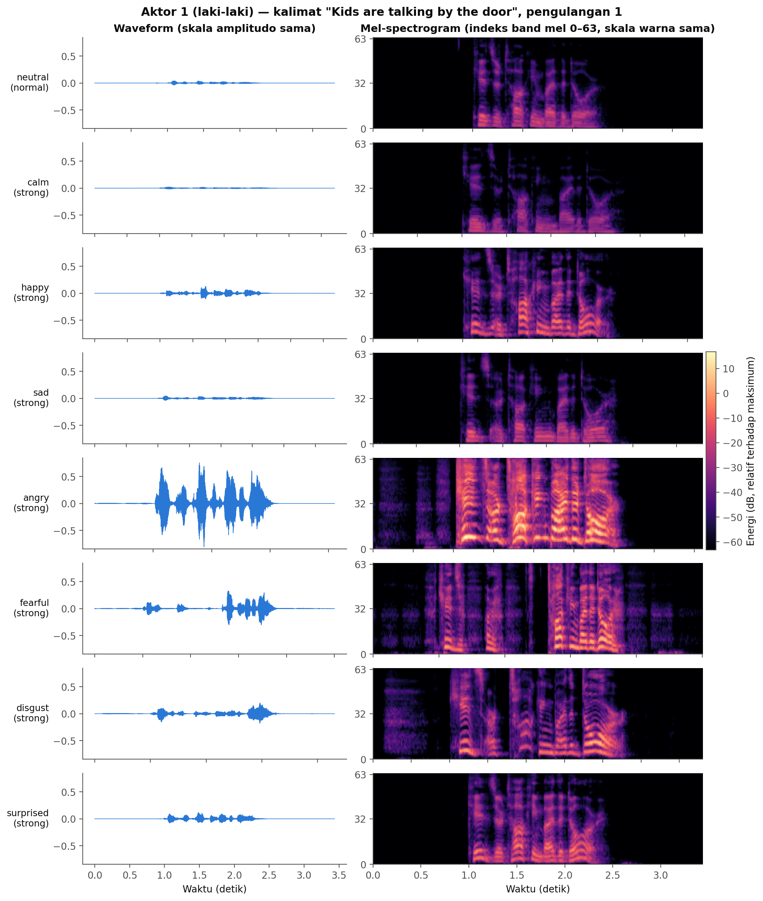

| Emosi | Waveform | Mel-spectrogram |
| --- | --- | --- |
| angry | Amplitudo terbesar, puncak sekitar ±0,7 | Energi kuat dan menyebar sampai pita mel tertinggi; harmonik sangat jelas |
| fearful | Amplitudo sedang-besar; ada jeda di tengah ucapan | Energi tinggi di bagian kedua ucapan; harmonik jelas |
| disgust, happy | Amplitudo sedang | Harmonik terlihat jelas, energi sampai pita tengah–atas |
| surprised | Amplitudo kecil-sedang | Energi terutama di pita bawah–tengah |
| neutral, calm, sad | Amplitudo sangat kecil | Energi lemah, terkonsentrasi di pita bawah |

- Pada semua emosi, ucapan dimulai sekitar detik 0,9–1,1 dan berakhir sekitar detik 2,5. Ini cocok dengan temuan hening ±1 detik di awal file.
- Pada angry, fearful, dan disgust terlihat pola energi lemah **sebelum** ucapan dimulai, kemungkinan suara napas atau noise latar. Perlu didengarkan untuk dipastikan.
- Aktor 2 (perempuan, ditinjau 21 November 2026): harmonik tampak lebih renggang daripada aktor 1, tanda nada suaranya lebih tinggi. Pola emosinya juga berbeda: happy diucapkan keras (puncak ±0,4, hampir sekeras angry), padahal pada aktor 1 happy tergolong sedang. Pada happy, fearful, dan surprised terlihat energi singkat sekitar detik 0,5–0,8 sebelum ucapan, kemungkinan tarikan napas.

**Implikasi:** perbedaan keras-lembut dan sebaran energi di frekuensi tinggi terlihat langsung, sehingga fitur energi (RMS) dan fitur spektral (centroid, rolloff, MFCC) kemungkinan berguna.

### Temuan 4 — Energi membedakan kelompok emosi, tetapi tumpang tindih di dalam kelompok

| Kelompok | Emosi (median RMS dB) |
| --- | --- |
| Energi rendah | calm −48,8 · neutral −47,4 · sad −44,6 |
| Energi sedang | disgust −40,9 · surprised −38,3 |
| Energi tinggi | happy −36,4 · fearful −34,6 · angry −29,7 |

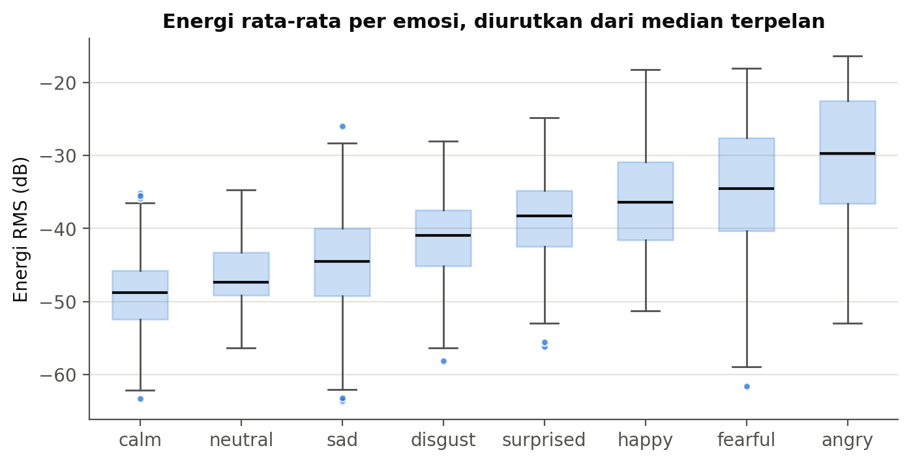

Selisih median angry dan calm 19,1 dB, artinya amplitudo rata-rata angry sekitar 9 kali calm. Urutan ini sesuai teori **arousal** (tingkat keterbangkitan emosi): emosi high-arousal diucapkan lebih keras.

Namun sebaran di setiap emosi lebar (simpangan baku keseluruhan 9,1 dB; fearful berkisar ±−59 sampai −18 dB), sehingga kotak-kotak di grafik saling tumpang tindih, terutama di dalam kelompok yang sama (calm–neutral–sad, happy–fearful–angry). Sebaran ini kemungkinan berasal dari perbedaan intensitas (normal/strong), perbedaan antaraktor, dan perbedaan level rekaman.

**Implikasi:** energi saja cukup untuk memisahkan emosi "keras" dari "pelan", tetapi tidak cukup untuk membedakan emosi di dalam kelompok yang sama. Dugaan awal: subset hasil simulated annealing akan memuat fitur energi ditambah fitur nada (F0) dan spektral. Dugaan ini bisa dibandingkan dengan hasil SA nanti.

### Temuan 5 — Separuh isi setiap file adalah hening

| Ukuran | Median | Rentang |
| --- | --- | --- |
| Hening awal | 0,96 s (50% data di 0,96–0,99 s) | 0,00–1,38 s |
| Hening akhir | 0,92 s (50% data di 0,87–0,97 s) | 0,00–1,35 s |
| Proporsi hening | 51% | 0,9–61,5% |
| Durasi bicara setelah trim | 1,79 s | 1,15–4,25 s |

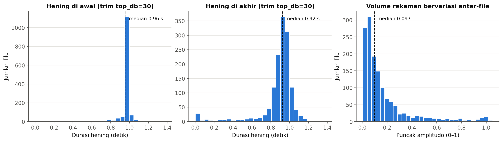

Hening awal sangat seragam di sekitar 1 detik, sehingga kemungkinan besar setiap klip memang dipotong dengan jeda ±1 detik sebelum dan sesudah ucapan. Ada sejumlah kecil file yang hening awal atau akhirnya hampir 0; penyebabnya belum diperiksa (lihat Tindak lanjut).

**Implikasi:** tanpa trim, sekitar separuh frame yang dianalisis adalah hening. Akibatnya rata-rata energi, ZCR, MFCC, dan rasio voiced F0 akan lebih banyak mencerminkan hening daripada cara bicara. **Trim hening wajib** sebelum ekstraksi fitur, dan `top_db=30` terbukti memotong jeda awal secara konsisten pada sebagian besar file.

### Temuan 6 — Volume rekaman umumnya pelan dan sangat bervariasi; ada kemungkinan clipping

- Median puncak amplitudo 0,097, artinya separuh file (734 file, 51%) puncaknya di bawah 10% dari batas maksimum.
- Rentang puncak 0,005–1,052, artinya file terkeras sekitar 200 kali lebih keras daripada yang terpelan.
- 18 file (1,25%) memiliki puncak ≥ 0,99, kemungkinan clipping. Nilai di atas 1,0 muncul karena proses resampling 48 → 16 kHz bisa sedikit melampaui nilai asli di sekitar puncak; ini menandakan rekaman aslinya sudah menyentuh batas maksimum.

**Implikasi:** fitur yang bergantung pada level absolut (RMS, koefisien MFCC pertama) dipengaruhi volume rekaman. Clipping sedikit mendistorsi bentuk spektrum, tetapi jumlahnya kecil.

## Keputusan untuk dibahas dengan Anggota B

EDA mengubah rencana preprocessing di satu titik penting: normalisasi amplitudo. Tiga hal lain cukup dikonfirmasi.

| No | Hal | Usulan berdasarkan EDA | Status |
| --- | --- | --- | --- |
| 1 | Konversi mono dan resample 16 kHz | Tetap sesuai rencana | Perlu dikonfirmasi B |
| 2 | Trim hening `top_db=30` | Tetap; terbukti konsisten memotong jeda ±1 detik | Perlu dikonfirmasi B |
| 3 | Normalisasi amplitudo | Anggota A mengekstrak fitur dua kali (tanpa normalisasi dan normalisasi puncak); Anggota B membandingkan keduanya di baseline | **Diputuskan A (21 November 2026); menunggu B menjalankan baseline** |
| 4 | 18 file kemungkinan clipping | Dipertahankan dan dicatat; jumlahnya kecil (1,25%) dan clipping juga terjadi di rekaman nyata | Diperkuat tindak lanjut (17 dari 18 file adalah angry strong); perlu dikonfirmasi B |

**Mengapa normalisasi amplitudo perlu diputuskan bersama**

Rencana awal memakai normalisasi puncak: setiap file diperbesar atau diperkecil sampai puncaknya sama. Temuan 4 dan 6 menunjukkan ada dua kepentingan yang bertabrakan:

- **Alasan menormalisasi:** volume rekaman sangat bervariasi (puncak 0,005–1,052). Sebagian variasi ini bisa berasal dari pengaturan rekaman, bukan dari emosi.
- **Alasan tidak menormalisasi:** energi adalah salah satu petunjuk emosi terkuat (selisih 19,1 dB antara angry dan calm). Normalisasi puncak membuat semua file sama keras di puncaknya, sehingga sebagian informasi "seberapa keras orang berbicara" ikut hilang.

| Pilihan | Cara | Kelebihan | Kekurangan |
| --- | --- | --- | --- |
| A. Tanpa normalisasi | Level asli dipertahankan | Informasi kekerasan suara utuh | Variasi level rekaman ikut masuk ke fitur |
| B. Normalisasi puncak (rencana awal) | Setiap file diskalakan sampai puncaknya 1 | Menghapus perbedaan level rekaman | Menghapus sebagian informasi energi; peka terhadap file clipping |
| C. Normalisasi RMS | Setiap file diskalakan sampai energi rata-ratanya sama | Lebih stabil daripada puncak | Menghapus informasi energi rata-rata sepenuhnya |

**Usulan:** Anggota B menjalankan baseline (semua fitur + SVM) untuk pilihan A dan B, lalu memilih yang macro F1-nya lebih tinggi **di data validation** (bukan test). Perbandingan ini murah dan bisa dilaporkan di paper sebagai ablation kecil tentang preprocessing. Konsekuensinya, Anggota A perlu mengekstrak fitur dua kali (dengan dan tanpa normalisasi) di langkah 5.

## Tindak lanjut EDA

Sel tindak lanjut sudah dijalankan pada 21 November 2026 (hasilnya di bagian berikutnya). Dua hal yang diperiksa:

1. **Daftar 18 file kemungkinan clipping:** emosi, intensitas, dan aktor apa? Dugaan: sebagian besar angry atau intensitas strong.
2. **File dengan hening awal atau akhir hampir 0:** apakah ucapannya terpotong di tepi file, atau trim gagal karena ada noise?

Sel berikut juga menghitung durasi bicara per emosi, energi per emosi × intensitas, dan energi per aktor. Ketiganya menjelaskan sumber sebaran energi di Temuan 4. Sel ini berdiri sendiri dan bisa dijalankan di sesi Colab baru:

```python
import os
import pandas as pd

try:
    from google.colab import drive
    drive.mount('/content/drive')
    BASE_DIR = '/content/drive/MyDrive/project07'
except ImportError:
    BASE_DIR = os.path.abspath('project07')

DATA_DIR = os.path.join(BASE_DIR, 'data')
meta = pd.read_csv(os.path.join(DATA_DIR, 'metadata.csv'))
stats = pd.read_csv(os.path.join(DATA_DIR, 'eda_audio_stats.csv'))
stats = meta[['file', 'actor', 'gender', 'emotion', 'intensity', 'duration_s']].merge(stats, on='file')
EMOSI = ['neutral', 'calm', 'happy', 'sad', 'angry', 'fearful', 'disgust', 'surprised']

klip = stats[stats['peak'] >= 0.99].sort_values('peak', ascending=False)
print(f'1) File kemungkinan clipping (peak >= 0.99): {len(klip)} file')
print(klip[['file', 'actor', 'emotion', 'intensity', 'peak']].to_string(index=False))
print('\nPer emosi:', klip['emotion'].value_counts().to_dict())
print('Per intensitas:', klip['intensity'].value_counts().to_dict())
print('Per aktor:', klip['actor'].value_counts().sort_index().to_dict())

tanpa = stats[(stats['lead_sil_s'] < 0.1) | (stats['trail_sil_s'] < 0.1)]
print(f'\n2) File dengan hening awal atau akhir < 0.1 s: {len(tanpa)} file')
print(tanpa[['file', 'emotion', 'intensity', 'lead_sil_s', 'trail_sil_s', 'speech_s']].round(3).to_string(index=False))

print('\n3) Durasi bicara setelah trim (median, detik) per emosi:')
print(stats.groupby('emotion')[['duration_s', 'speech_s']].median().reindex(EMOSI).round(2).to_string())

print('\n4) Energi RMS (median dB) per emosi dan intensitas:')
print(stats.pivot_table(index='emotion', columns='intensity', values='rms_db', aggfunc='median').reindex(EMOSI).round(1).to_string())

print('\n5) Energi RMS (median dB) per aktor, dari terpelan:')
print(stats.groupby('actor')['rms_db'].median().sort_values().round(1).to_string())
```

## Hasil tindak lanjut EDA (21 November 2026)

Clipping ternyata hampir seluruhnya terjadi pada angry intensitas strong, sehingga merupakan sifat alami emosi itu dan filenya dipertahankan. File dengan hening hampir nol kemungkinan besar menyisakan bunyi bukan-ucapan di tepi file, tetapi perlu dipastikan dengan didengarkan. Temuan baru yang paling penting: level suara antaraktor berbeda hingga 18 dB.

### 1. File kemungkinan clipping (18 file)

| Aspek | Hasil |
| --- | --- |
| Emosi | angry 17, fearful 1 |
| Intensitas | strong 18 |
| Aktor | 14 aktor berbeda; terbanyak aktor 20 (3 file) |
| Sebaran di split | train 12, validation 4, test 2 |
| Porsi | 8,9% dari semua file angry; 17,7% dari angry strong |

**Interpretasi:** clipping terjadi ketika aktor berteriak pada intensitas strong. Ini sifat dari emosi yang sangat keras, bukan kesalahan rekaman acak.

**Keputusan (usulan, perlu dikonfirmasi B):** file dipertahankan. Membuangnya justru menghapus contoh angry paling keras, sehingga kelas angry menjadi bias ke versi yang lebih pelan. Temuan ini dicatat di dataset card.

### 2. File dengan hening awal atau akhir di bawah 0,1 detik (53 file, 3,7%)

| Aspek | Hasil |
| --- | --- |
| Pola | 33 file hening akhirnya ±0 (hening awal normal ±1 s); 19 file hening awalnya ±0; 1 file keduanya |
| Intensitas | strong 31, normal 22 |
| Aktor terbanyak | aktor 3 dan 9 (masing-masing 9), aktor 15 dan 19 (masing-masing 7) |
| Sebaran di split | train 44, validation 9, test 0 |
| Durasi bicara setelah trim | 2,21–4,25 s, lebih panjang daripada median semua file (1,79 s) |

**Interpretasi:** "durasi bicara" pada file ini lebih panjang dari biasanya. Jadi kemungkinan besar trim tidak membuang bunyi bukan-ucapan di tepi file (napas, klik, atau noise), bukan ucapan yang terpotong. Grafik aktor 2 juga memperlihatkan tarikan napas sebelum ucapan. Dugaan ini perlu dipastikan dengan pemeriksaan dengar di bawah.

**Dampak:** kecil. Hanya 3,7% file, tidak ada yang di data test, dan bunyi yang tersisa pendek. Fitur file-file ini sedikit tercampur bunyi bukan-ucapan.

### 3. Energi per emosi dan intensitas

| Emosi | Normal (dB) | Strong (dB) | Selisih (dB) |
| --- | --- | --- | --- |
| angry | −36,7 | −22,5 | 14,2 |
| fearful | −39,9 | −27,8 | 12,1 |
| happy | −41,6 | −31,3 | 10,3 |
| sad | −47,5 | −40,7 | 6,8 |
| disgust | −43,5 | −38,1 | 5,4 |
| surprised | −40,2 | −36,0 | 4,2 |
| calm | −48,8 | −48,8 | 0,0 |
| neutral | −47,4 | — | — |

**Interpretasi:** intensitas strong jauh lebih keras untuk emosi high-arousal (angry, fearful, happy), sedikit lebih keras untuk disgust dan surprised, dan sama sekali tidak berbeda untuk calm. Pada intensitas normal, rentang energi antaremosi hanya 12,1 dB (−48,8 sampai −36,7), sedangkan pada strong 26,3 dB. Jadi sebagian besar sebaran energi di Temuan 4 berasal dari campuran intensitas.

**Implikasi:** emosi pada intensitas normal kemungkinan lebih sulit dibedakan. Saat error analysis, performa sebaiknya dilaporkan terpisah per intensitas.

### 4. Energi per aktor

Median energi per aktor berkisar dari −52,9 dB (aktor 9) sampai −34,9 dB (aktor 10), selisih **18,0 dB**. Angka ini hampir sama dengan selisih antara angry dan calm (19,1 dB). Aktor 9 (data train) paling pelan, 7,1 dB di bawah aktor terpelan berikutnya. Tiga dari empat aktor test (21, 23, 24) lebih keras daripada median aktor (−39,8 dB).

**Interpretasi:** sebagian perbedaan energi berasal dari orangnya atau level rekamannya, bukan dari emosi. Model yang belajar "keras berarti angry" bisa salah pada speaker yang suaranya memang keras atau pelan.

**Implikasi:**

- Memperkuat usulan membandingkan tanpa normalisasi vs normalisasi puncak di baseline.
- Relevan langsung dengan failure experiment: fitur energi mungkin tidak stabil lintas speaker.
- Normalisasi per speaker (menyamakan level setiap aktor) adalah pilihan lain yang dipakai di riset SER. Pilihan ini memakai data dari speaker test sehingga tidak masuk pipeline utama, tetapi bisa menjadi bahan research seed.

### 5. Durasi bicara per emosi

Setelah trim, median durasi bicara 1,63 s (neutral, surprised) sampai 2,08 s (disgust). Selisihnya kecil, konsisten dengan Temuan 2.

### Pemeriksaan dengar (perlu dilakukan, ±15 menit)

**Tujuan:** memastikan penyebab hening hampir nol pada 53 file: bunyi bukan-ucapan yang ikut tersisa, atau ucapan yang terpotong di tepi file.

**Cara:** jalankan sel di bawah. Sel ini menampilkan waveform 5 file contoh dengan bagian yang dibuang trim diarsir abu-abu dan batas trim ditandai garis putus-putus, menyimpan gambar `figures/eda/eda_08_cek_trim.png`, lalu memutar kelima audio. Dengarkan terutama bagian di dekat tepi yang **tidak** diarsir.

Cara paling aman adalah mengunggah notebook `Langkah3b_AnggotaA_Cek_Dengar.ipynb` ke Colab. Jika menyalin kode di bawah, pastikan indentasi (spasi di awal baris) ikut tersalin dan tidak ada baris yang terpotong; salinan yang terpotong menyebabkan `SyntaxError: unterminated string literal` (terjadi pada 21 November 2026).

```python
import os
import numpy as np
import matplotlib.pyplot as plt
import librosa
from IPython.display import Audio, display

try:
    from google.colab import drive
    drive.mount('/content/drive')
    BASE_DIR = '/content/drive/MyDrive/project07'
except ImportError:
    BASE_DIR = os.path.abspath('project07')

DATA_DIR = os.path.join(BASE_DIR, 'data')
AUDIO_DIR = os.path.join(DATA_DIR, 'raw', 'ravdess_speech')
FIG_DIR = os.path.join(BASE_DIR, 'figures', 'eda')
os.makedirs(FIG_DIR, exist_ok=True)
SR = 16000
TOP_DB = 30

CONTOH = [
    'Actor_19/03-01-07-02-01-02-19.wav',
    'Actor_12/03-01-04-01-01-02-12.wav',
    'Actor_03/03-01-06-02-02-02-03.wav',
    'Actor_09/03-01-01-01-01-01-09.wav',
    'Actor_01/03-01-06-01-02-01-01.wav',
]

n = len(CONTOH)
fig, axes = plt.subplots(
    n, 1, figsize=(11, 2.1 * n),
    layout='constrained')

for ax, f in zip(axes, CONTOH):
    path = os.path.join(AUDIO_DIR, f)
    y, _ = librosa.load(path, sr=SR, mono=True)
    t = np.arange(len(y)) / SR
    _, (awal, akhir) = librosa.effects.trim(
        y, top_db=TOP_DB)
    s_awal = awal / SR
    s_akhir = akhir / SR
    hen_akhir = max(0.0, len(y) - akhir) / SR

    ax.plot(t, y, color='#2a78d6', linewidth=0.5)
    ax.axvspan(0, s_awal, color='#e4e3df',
               alpha=0.9, label='dibuang trim')
    ax.axvspan(s_akhir, t[-1], color='#e4e3df',
               alpha=0.9)
    ax.axvline(s_awal, color='#0b0b0b',
               linestyle='--', linewidth=1)
    ax.axvline(s_akhir, color='#0b0b0b',
               linestyle='--', linewidth=1)
    judul = (f'{f} | hening awal {s_awal:.2f} s, '
             f'akhir {hen_akhir:.2f} s')
    ax.set_title(judul, fontsize=10, loc='left')
    ax.set_xlim(0, t[-1])
    ax.spines[['top', 'right']].set_visible(False)

axes[0].legend(loc='upper left', fontsize=9)
axes[-1].set_xlabel(
    'Waktu (detik); garis putus-putus = batas trim')
out = os.path.join(FIG_DIR, 'eda_08_cek_trim.png')
fig.savefig(out, dpi=200)
print('Tersimpan:', out)
plt.show()

for f in CONTOH:
    print(f)
    display(Audio(os.path.join(AUDIO_DIR, f)))
```

**Output yang diinginkan:** tabel berikut diisi setelah mendengarkan, plus gambar `eda_08_cek_trim.png`.

**Hasil pemeriksaan (21 November 2026)**

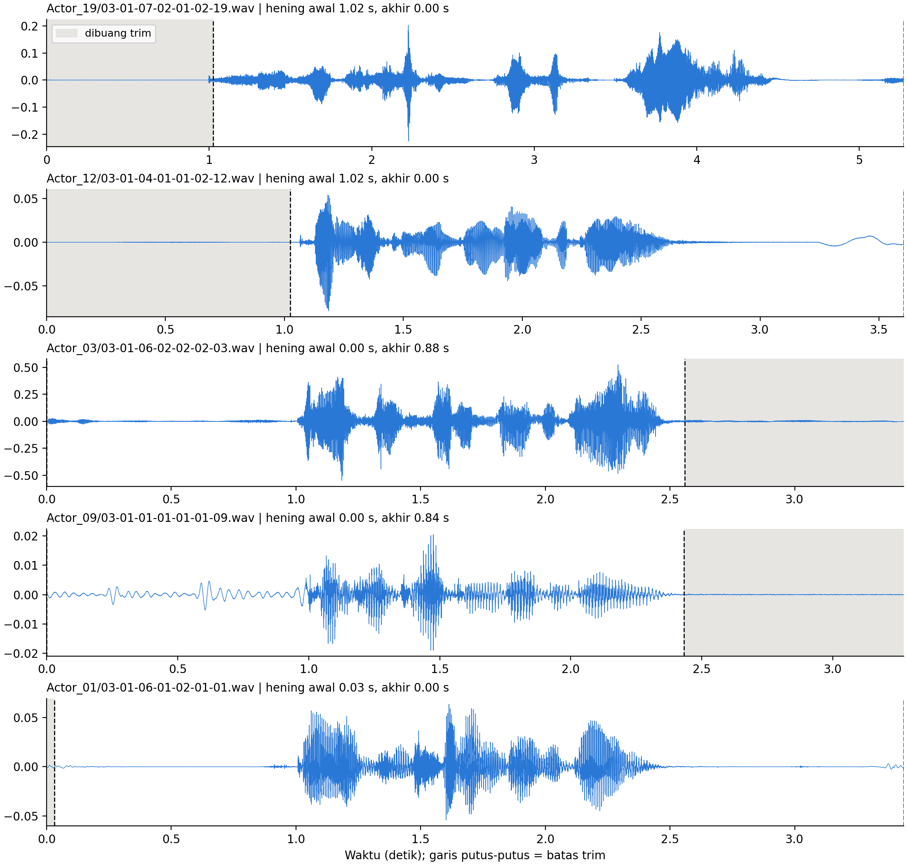

| File | Ucapan | Bunyi di tepi yang tidak terpotong | Penyebab trim tidak memotong | Keputusan |
| --- | --- | --- | --- | --- |
| `Actor_19/03-01-07-02-01-02-19.wav` (disgust, strong) | ±1,0–4,5 s, utuh | Sinyal sangat kecil setelah ucapan sampai ujung file (±4,5–5,3 s) | Noise latar atau sisa napas di akhir | Dipertahankan |
| `Actor_12/03-01-04-01-01-02-12.wav` (sad, normal) | ±1,05–2,8 s, utuh | Gelombang pelan berbentuk gundukan di ±3,3–3,6 s | Kemungkinan benturan pelan, mikrofon tersentuh, atau embusan napas | Dipertahankan |
| `Actor_03/03-01-06-02-02-02-03.wav` (fearful, strong) | ±1,0–2,55 s, utuh | Letupan kecil di ±0,0–0,15 s | Klik atau napas di awal | Dipertahankan |
| `Actor_09/03-01-01-01-01-01-09.wav` (neutral, normal) | ±0,95–2,45 s, utuh | Gelombang kecil berulang sepanjang 0–0,95 s; volume file jauh lebih kecil daripada file lain (puncak ±0,02) | Dengung atau noise latar yang ikut terhitung karena rekaman sangat pelan | Dipertahankan |
| `Actor_01/03-01-06-01-02-01-01.wav` (fearful, normal) | ±1,0–2,5 s, utuh | Klik kecil di ±0,02 s dan ±3,4 s | Klik di kedua tepi | Dipertahankan |

Deskripsi bunyi disimpulkan dari bentuk gelombang bersama hasil mendengarkan; pengamatan dengar yang paling jelas adalah volume file aktor 9 yang jauh lebih kecil. Untuk konfirmasi tambahan, dengarkan pada detik yang disebut di tabel.

**Kesimpulan:** pada kelima file, ucapan utuh dan dimulai sekitar detik 1,0, sesuai jeda ±1 detik dari pembuat dataset. Tidak ada ucapan yang terpotong. Trim tidak memotong tepi karena ada bunyi kecil bukan-ucapan di sana (klik, noise, dengung, atau gundukan pelan).

**Mengapa rekaman pelan lebih sering terkena:** `top_db=30` membuang bagian yang 30 dB lebih pelan daripada bagian terkeras **file itu sendiri**. Pada rekaman yang sangat pelan, jarak antara ucapan dan noise latar kecil, sehingga noise tidak dianggap hening. Ini sejalan dengan aktor 9, aktor terpelan (median −52,9 dB), yang termasuk paling banyak memiliki file seperti ini (9 dari 53 file).

**Keputusan:** semua 53 file dipertahankan dan pipeline tidak diubah. Pada file-file ini (3,7%, tidak ada di data test), segmen hasil trim masih membawa sedikit bunyi bukan-ucapan sehingga fiturnya sedikit tercampur. Dicatat sebagai keterbatasan kecil di dataset card dan paper. Alternatif seperti deteksi ucapan berbasis segmen (`librosa.effects.split`) tidak dipakai agar preprocessing tetap sederhana dan sama untuk semua file.

## Langkah 4 — Preprocessing

Preprocessing dijalankan pada 21 November 2026 dengan notebook `Langkah4_AnggotaA_Preprocessing.ipynb`. Semua 1.440 file berhasil diproses, dan 5/5 uji modul serta 8/8 verifikasi lolos. Temuan terpenting: normalisasi puncak menghapus hampir seluruh perbedaan energi antaremosi (19,3 → 1,2 dB), sekaligus mengurangi sebagian besar perbedaan antaraktor (18,5 → 4,5 dB).

### Yang dikerjakan

| Sel | Isi | Hasil |
| --- | --- | --- |
| 1 | Persiapan dan cek prasyarat | Prasyarat lengkap |
| 2 | Parameter disimpan ke `config.json` | `config_hash` = `d930ff28cd` |
| 3 | Menulis modul `src/preprocess.py` | 5 fungsi: `load_audio`, `trim_silence`, `normalize`, `preprocess_signal`, `preprocess_file` |
| 4 | Uji modul sebelum dipakai | 5/5 lolos, termasuk bukti bahwa batas trim tidak berubah saat volume diubah (10/10 file asli) |
| 5 | Memproses 1.440 file | 0 gagal; `preprocess_log.csv` tersimpan |
| 6 | Verifikasi hasil | 8/8 OK |
| 7 | Grafik | `pre_01_sebelum_sesudah.png`, `pre_02_durasi.png`, `pre_03_energi_none_vs_peak.png` |
| 8 | Ringkasan dan dokumentasi | `preprocess_summary.txt`, `docs/README_langkah4_preprocessing.md` |

### Parameter

| Parameter | Nilai | Alasan |
| --- | --- | --- |
| `target_sr` | 16.000 Hz | Rentang frekuensi suara bicara tetap tercakup; komputasi lebih ringan |
| `mono` | True | 5 file stereo terbukti identik kiri-kanan |
| `trim_top_db` | 30 dB | EDA: memotong jeda ±1 detik secara konsisten |
| `trim_frame_length`, `trim_hop_length` | 2.048, 512 sampel | Sama dengan EDA |
| `peak_target` | 0,99 | Sedikit di bawah batas maksimum |
| Normalisasi | `'none'` atau `'peak'` | Dibandingkan di baseline; audio disimpan versi `'none'` |

### Keputusan desain

- **Satu modul untuk semua bagian proyek.** Langkah 5 dan demo Anggota C memanggil `src/preprocess.py` yang sama, sehingga audio diproses dengan cara yang persis sama di mana pun.
- **Audio disimpan satu versi (tanpa normalisasi).** Trim mengukur hening relatif terhadap bagian terkeras file, sehingga batasnya tidak berubah saat volume diubah (terbukti di Sel 4). Normalisasi puncak hanyalah perkalian dengan satu angka, jadi dilakukan saat ekstraksi fitur.
- **Format float32**, agar nilai di atas 1,0 pada file clipping tidak terpotong lagi.
- **Semua file dipertahankan**, sesuai keputusan langkah 3.

### Hasil

| Ukuran | Hasil |
| --- | --- |
| File diproses | 1.440 (0 gagal) |
| Durasi sebelum trim | median 3,67 s (2,94–5,27 s) |
| Durasi sesudah trim | median 1,79 s (1,15–4,25 s) |
| Proporsi yang dibuang | median 51% |
| Total durasi | 88,8 menit → 45,5 menit |
| Puncak setelah trim | median 0,097; 18 file ≥ 0,99 (file clipping dari EDA) |
| Faktor normalisasi puncak | −0,5 sampai +46,8 dB (median +20,2 dB) |

- Durasi hasil sama persis dengan durasi bicara di EDA (selisih 0,0000 s), jadi preprocessing konsisten dengan analisis langkah 3.
- Faktor −0,5 dB berarti file clipping sedikit dikecilkan (puncak ±1,05 → 0,99). Faktor +46,8 dB berarti file terpelan diperbesar sekitar 219 kali. Karena seluruh sinyal dikalikan angka yang sama, perbandingan ucapan dan noise latar di file itu tidak berubah.
- Contoh file (aktor 1, angry, strong): 4,10 s → 2,08 s; puncak 0,805 → 0,990 setelah normalisasi puncak.

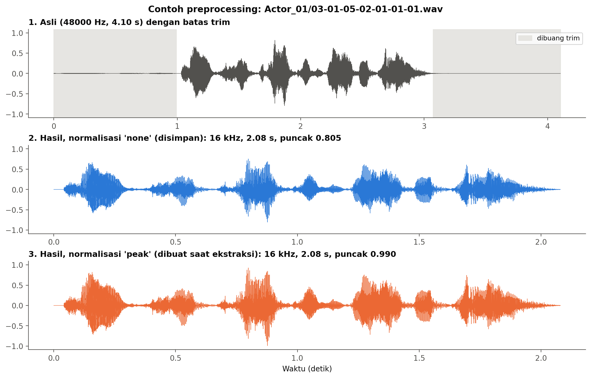

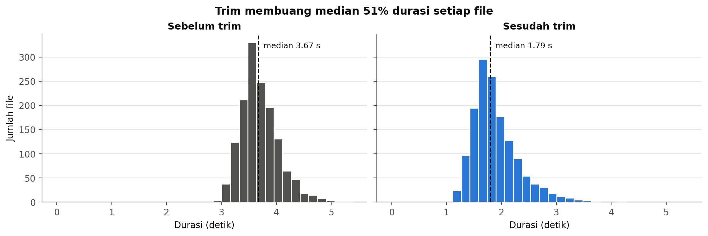

### Verifikasi

| No | Pemeriksaan | Hasil |
| --- | --- | --- |
| 1 | Jumlah baris log = jumlah file metadata | OK (1.440 / 1.440) |
| 2 | Semua file hasil ada | OK (1.440 file) |
| 3 | Format 16 kHz, mono, float32 (30 file acak) | OK |
| 4 | Tidak ada NaN atau nilai tak hingga (30 file acak) | OK |
| 5 | Durasi terpendek setelah trim ≥ 0,5 s | OK (1,15 s) |
| 6 | Durasi hasil = durasi bicara EDA | OK (selisih maks 0,0000 s) |
| 7 | Proses ulang = file tersimpan (10 file acak) | OK (selisih maks 0) |
| 8 | Normalisasi `'peak'` menghasilkan puncak 0,99 (10 file acak) | OK |

### Temuan utama: dampak normalisasi puncak pada energi

| Versi | Rentang antaremosi | Rentang antaraktor |
| --- | --- | --- |
| `'none'` (tanpa normalisasi) | 19,3 dB | 18,5 dB |
| `'peak'` (normalisasi puncak) | 1,2 dB (turun 94%) | 4,5 dB (turun 76%) |

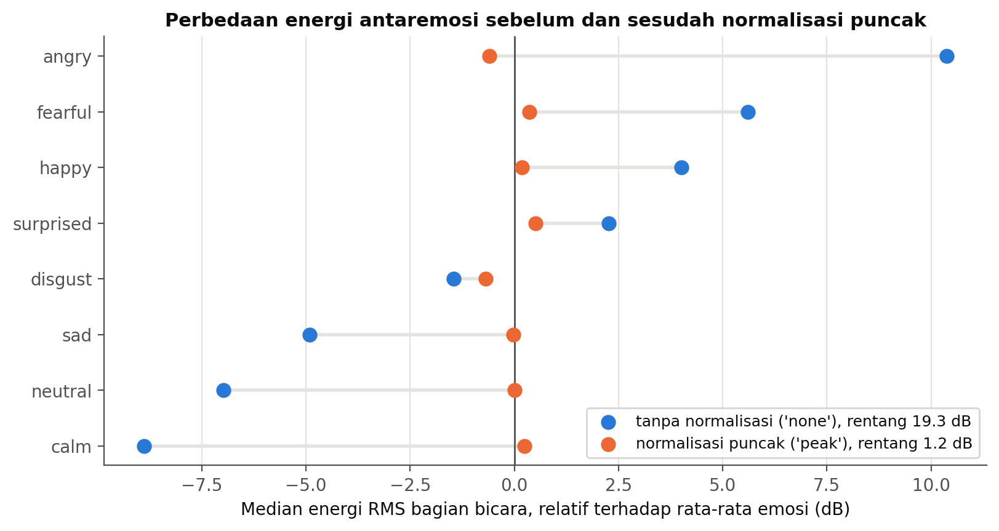

Rentang dihitung dari median energi RMS bagian bicara per emosi dan per aktor.

**Interpretasi**

- Normalisasi puncak menghapus hampir seluruh perbedaan keras-pelan antaremosi, dan juga sebagian besar perbedaan antaraktor. Setelah normalisasi, sisa perbedaan antaraktor (4,5 dB) justru lebih besar daripada sisa perbedaan antaremosi (1,2 dB).
- Setelah normalisasi puncak, energi RMS tidak lagi mengukur seberapa keras orang berbicara, melainkan perbandingan energi rata-rata terhadap puncaknya. Itulah sebabnya angry turun sedikit di bawah rata-rata: teriakan memiliki puncak yang tajam.
- **Fitur yang terpengaruh hanya fitur yang bergantung pada level absolut:** energi RMS (rata-rata, simpangan baku, maksimum) dan koefisien MFCC ke-0 jika ikut dihitung. Fitur yang bergantung pada bentuk spektrum dan nada, yaitu MFCC ke-1 dan seterusnya, delta MFCC, F0, ZCR, spectral centroid, bandwidth, rolloff, flatness, contrast, dan chroma, tidak berubah jika sinyal dikalikan konstanta.
- Jadi perbandingan `'none'` vs `'peak'` di baseline pada dasarnya menjawab satu pertanyaan: **apakah informasi level suara absolut membantu atau justru merugikan saat model diuji pada speaker yang belum pernah didengar?** Versi `'none'` menyimpan petunjuk emosi yang kuat tetapi tercampur perbedaan antaraktor; versi `'peak'` menghapus keduanya.

**Implikasi**

- **Untuk Anggota B:** tabel di atas adalah bahan diskusi utama untuk keputusan normalisasi. Hasilnya tidak bisa ditebak dari EDA saja, sehingga perbandingan baseline tetap diperlukan.
- **Untuk langkah 5:** daftar fitur harus mencatat apakah koefisien MFCC ke-0 ikut dihitung. Karena sebagian besar fitur tidak terpengaruh skala, fitur yang lambat dihitung (terutama F0 dengan `pyin`) cukup dihitung sekali untuk kedua versi.
- **Untuk paper:** temuan ini bisa dibahas sebagai analisis preprocessing dan dikaitkan dengan uji stabilitas lintas speaker. Normalisasi per speaker bisa menjadi bahan research seed.

## Langkah 5 — Ekstraksi fitur

Ekstraksi fitur dijalankan pada 21–22 November 2026 dengan notebook `Langkah5_AnggotaA_Ekstraksi_Fitur.ipynb`. Semua 1.440 file menghasilkan 90 fitur dalam dua versi, dan 6/6 uji modul serta 9/9 verifikasi lolos. Tabel nama fitur (rencana langkah 6) ikut dibuat di langkah ini.

### Yang dikerjakan

| Sel | Isi | Hasil |
| --- | --- | --- |
| 1–2 | Persiapan, cek prasyarat, parameter ke `config.json` | `config_hash` fitur `0c3114fc78` (preprocessing `d930ff28cd`) |
| 3 | Modul `src/features.py` | `FEATURE_NAMES`, `FEATURE_TABLE`, `extract_f0_features`, `extract_features`, `extract_features_dict` |
| 4 | Uji modul | 6/6 lolos: F0 nada buatan tepat, noise tidak terdeteksi bersuara, audio 0,05 s aman, 87 fitur tidak bergantung volume |
| 5 | Ekstraksi dua versi dengan checkpoint per 100 file | `features_none.csv`, `features_peak.csv`, `feature_names.csv`, `features_meta.json` |
| 6 | Verifikasi | 9/9 OK |
| 7 | Grafik deskriptif (aktor 1–16) | `feat_01_f0_per_emosi_gender.png`, `feat_02_profil_fitur_per_emosi.png` |
| 8 | Ringkasan dan dokumentasi | `features_summary.txt`, `docs/README_langkah5_ekstraksi_fitur.md` |

### Fitur yang diekstrak (90)

| Kelompok | Jumlah | Fitur |
| --- | --- | --- |
| `mfcc` | 26 | MFCC ke-1 sampai 13, mean dan std |
| `delta_mfcc` | 26 | Delta MFCC ke-1 sampai 13, mean dan std |
| `prosodi` | 6 | F0 mean, std, persentil 5, persentil 95, rentang, `voiced_ratio` |
| `energi` | 3 | RMS mean, std, max (satu-satunya yang bergantung volume) |
| `zcr` | 2 | Zero-crossing rate mean, std |
| `spektral` | 8 | Centroid, bandwidth, rolloff, flatness (mean, std) |
| `contrast` | 7 | Spectral contrast 7 pita (mean) |
| `chroma` | 12 | Chroma 12 kelas nada (mean) |

Frame `n_fft=512` (32 ms), `hop_length=160` (10 ms). F0 dengan pyin, 65–500 Hz, frame 1.024 sampel.

### Keputusan desain

| Keputusan | Alasan |
| --- | --- |
| MFCC ke-0 tidak dipakai | Mewakili energi total yang sudah ada di `rms_*`; perbedaan versi none/peak terkumpul di 3 fitur energi |
| F0 memakai persentil 5 dan 95 | Lebih tahan terhadap kesalahan oktaf daripada minimum dan maksimum |
| File tanpa frame bersuara: statistik F0 = 0 | Menghindari nilai kosong; ditandai `voiced_ratio = 0` |
| Fitur non-energi dihitung dari salinan sinyal berpuncak 1 | Ditemukan saat pengujian: `spectral_flatness` librosa bergeser ±7% pada frame pelan jika volume diubah, karena memakai batas bawah tetap |
| F0 dihitung sekali untuk kedua versi | F0 tidak berubah saat volume diubah (diuji) |
| Grafik deskriptif hanya aktor 1–16 | Data validation dan test tidak diintip |
| Checkpoint setiap 100 file | Jika Colab terputus, proses dilanjutkan, bukan diulang (diuji: hasil identik) |

### Verifikasi

| No | Pemeriksaan | Hasil |
| --- | --- | --- |
| 1 | Kedua tabel berisi semua file | OK (1.440 dan 1.440 baris) |
| 2 | 90 kolom fitur sesuai `feature_names.csv` | OK |
| 3 | Tidak ada NaN atau nilai tak hingga | OK |
| 4 | Kolom info sama dengan `metadata.csv` | OK |
| 5 | 87 fitur non-energi identik antara none dan peak | OK (selisih relatif maks 5,6 × 10⁻⁴) |
| 6 | Rasio energi peak/none = faktor normalisasi | OK (selisih relatif maks 3,4 × 10⁻⁷) |
| 7 | Ekstraksi ulang 5 file acak = hasil tersimpan | OK |
| 8 | F0 di 65–500 Hz dan `voiced_ratio` di 0–1 | OK (F0 mean 78–492 Hz; 5 file tanpa frame bersuara) |
| 9 | Tidak ada fitur konstan | OK |

### Temuan

**1. Nada dasar (F0) naik seiring tingkat arousal, tetapi sangat dipengaruhi gender.**

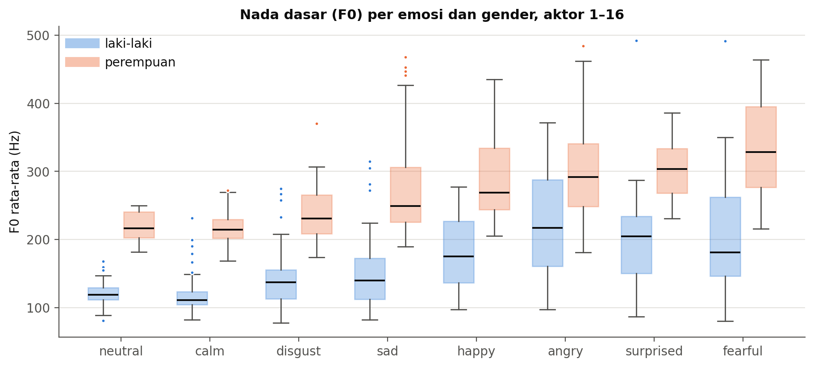

Median F0 (aktor 1–16): laki-laki 149 Hz, perempuan 259 Hz. Pada kedua gender, F0 terendah ada di neutral dan calm, lalu naik ke disgust dan sad, dan tertinggi di happy, angry, surprised, dan fearful. Namun selisih antargender (±100 Hz) hampir sebesar selisih antaremosi: F0 perempuan saat neutral (±215 Hz) setara dengan F0 laki-laki saat angry atau surprised (±205–220 Hz).

**Implikasi:** nilai F0 absolut tercampur pengaruh gender dan speaker. Inilah kemungkinan alasan tidak ada fitur prosodi di daftar 15 teratas, walaupun grafiknya menunjukkan pola jelas: sebaran di dalam tiap emosi menjadi lebar. Ini relevan untuk uji stabilitas lintas speaker.

**2. Profil fitur per emosi (heatmap).**

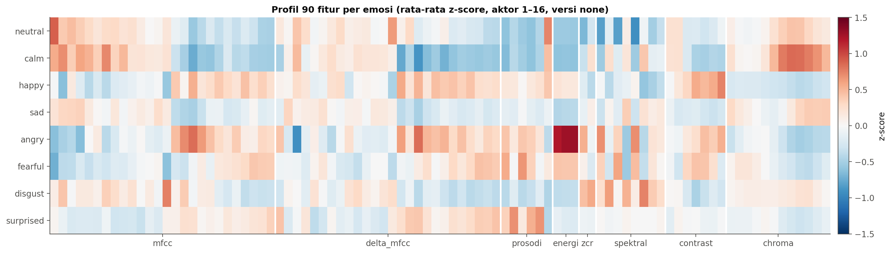

- Energi: angry paling menonjol (z ≈ +1,3), sedangkan neutral, calm, dan sad di bawah rata-rata. Sesuai temuan EDA.
- MFCC ke-1 (kemiringan spektrum): tinggi pada neutral dan calm (suara lebih "gelap"), rendah pada angry dan fearful (lebih "terang").
- Chroma: tinggi pada calm dan neutral, rendah pada happy dan angry. Kemungkinan chroma di sini lebih mencerminkan sebaran energi frekuensi rendah daripada nada musik.
- Nilai z maksimum antaremosi hanya 1,88, artinya sebaran setiap fitur antaremosi banyak tumpang tindih. Tidak ada satu fitur yang cukup sendirian; kombinasi fitur diperlukan.

**3. 15 fitur dengan perbedaan rata-rata antaremosi terbesar** (deskriptif, aktor 1–16, versi none; **bukan seleksi fitur**)

| Peringkat | Fitur | Kelompok | Selisih z |
| --- | --- | --- | --- |
| 1–3 | `rms_max`, `rms_std`, `rms_mean` | energi | 1,88; 1,85; 1,80 |
| 4 | `dmfcc04_std` | delta\_mfcc | 1,72 |
| 5 | `mfcc01_mean` | mfcc | 1,62 |
| 6 | `rolloff_mean` | spektral | 1,61 |
| 7 | `mfcc04_std` | mfcc | 1,57 |
| 8 | `centroid_mean` | spektral | 1,51 |
| 9 | `bandwidth_mean` | spektral | 1,40 |
| 10 | `dmfcc03_mean` | delta\_mfcc | 1,39 |
| 11 | `dmfcc02_std` | delta\_mfcc | 1,38 |
| 12 | `mfcc01_std` | mfcc | 1,37 |
| 13 | `chroma09_mean` | chroma | 1,35 |
| 14 | `rolloff_std` | spektral | 1,33 |
| 15 | `mfcc02_mean` | mfcc | 1,33 |

Energi menempati tiga teratas pada versi none, konsisten dengan EDA. Berikutnya didominasi fitur kemiringan dan "keterangan" spektrum (MFCC ke-1, rolloff, centroid, bandwidth) serta laju perubahan spektrum (delta MFCC). Daftar ini akan dibandingkan dengan fitur yang dipilih simulated annealing.

**4. Lima file tanpa frame bersuara.** pyin tidak mendeteksi nada di 5 file (0,35%), sehingga statistik F0-nya 0. Nama filenya akan diperiksa di notebook langkah 7.

### Tindak lanjut

- Periksa 5 file tanpa frame bersuara: selesai di langkah 7 (lihat bagian Langkah 7).
- Kirim pesan ke Anggota B (tabel fitur siap untuk baseline) dan Anggota C (`src/features.py` untuk demo); lihat bagian Komunikasi.

## Langkah 6 — Tabel nama fitur

Langkah 6 di Rencana Kerja (tabel nama fitur) dikerjakan sekaligus di notebook langkah 5, jadi tidak ada notebook terpisah. Hasilnya adalah `data/features/feature_names.csv` (90 baris).

| Diminta Rencana Kerja | Isi `feature_names.csv` |
| --- | --- |
| index | 0–89, sama dengan urutan kolom fitur di `features_none.csv` dan `features_peak.csv` |
| Nama (misalnya `mfcc03_mean`) | Kolom `name` |
| Kelompok | Kolom `group` berisi 8 kelompok (mfcc, delta\_mfcc, prosodi, energi, zcr, spektral, contrast, chroma), lebih rinci daripada 6 kelompok di rencana |
| Penjelasan singkat | Kolom `description` |
| (tambahan) | Kolom `scale_dependent`: menandai 3 fitur energi yang berubah jika volume diubah |

## Langkah 5b — Skrip reproduksi fitur (Definition of done)

Rencana Kerja mensyaratkan bahwa perintah `python extract_features.py --config config.json` dari nol menghasilkan tabel fitur yang identik. Notebook `Langkah5b_AnggotaA_Skrip_Reproduksi.ipynb` menulis skrip itu dan membuktikannya pada 22 November 2026.

### Yang dikerjakan

1. Menulis `project07/extract_features.py` (versi 1.0). Alurnya: audio asli 48 kHz → `src/preprocess.py` → `src/features.py` → `features_none.csv`, `features_peak.csv`, `feature_names.csv`, dan `features_meta.json`. Parameter dibaca dari `config.json`, sedangkan urutan file dan label dibaca dari nama file. Opsi `--compare` membandingkan hasil dengan tabel lain sel per sel.
2. Uji cepat pada aktor 1–2, lalu reproduksi penuh 1.440 file dari audio asli ke folder terpisah dengan pemrosesan paralel. Tabel resmi tidak ditimpa.
3. Menyimpan bukti di `data/features/repro_check.json` dan dokumentasi di `docs/README_extract_features.md`. Folder hasil uji dihapus setelah terbukti identik.

### Hasil

| Ukuran | Hasil |
| --- | --- |
| Waktu | 18,6 menit untuk 1.440 file |
| File gagal | 0 |
| `features_none.csv` | 129.600 dari 129.600 sel sama persis, selisih maksimum 0 |
| `features_peak.csv` | 129.600 dari 129.600 sel sama persis, selisih maksimum 0 |
| `feature_names.csv` | Sama |
| config\_hash | features `0c3114fc78`, preprocessing `d930ff28cd` (cocok dengan `config.json`) |
| Verifikasi | 9/9 OK |

**Kesimpulan: identik persis (bit per bit).** Versi library saat verifikasi: Python 3.13.18, numpy 2.4.6, pandas 2.2.3, librosa 0.11.0, soundfile 0.14.0. Versi ini dicatat di `requirements.txt`, karena hasil identik bit per bit hanya dijamin dengan versi library yang sama.

### Status Definition of done Anggota A

| Syarat di Rencana Kerja | Status |
| --- | --- |
| `python extract_features.py --config config.json` dari nol menghasilkan tabel fitur identik | Terpenuhi (langkah 5b) |
| Tidak ada NaN; jika F0 tidak terdeteksi, isi 0 dan rasio voiced = 0, lalu catat jumlah kasusnya | Terpenuhi (langkah 5: tanpa NaN; langkah 7: 5 kasus diperiksa) |
| Jumlah baris tabel fitur = 1.440 dan setiap aktor muncul hanya di satu split | Terpenuhi (langkah 5 dan 7) |

## Langkah 7–8 — Split data dan partisi uji stabilitas

Di Rencana Kerja, split (langkah 7) dan partisi untuk failure experiment (langkah 8) adalah dua langkah terpisah. Keduanya dikerjakan dalam satu notebook karena memakai data dan pemeriksaan yang sama.

### Yang dikerjakan

Notebook `Langkah7_AnggotaA_Split_Partisi.ipynb` dijalankan pada 22 November 2026 dini hari WIB. Tanggal di file tertulis 2026-11-21 karena jam Colab memakai UTC. Notebook ini:

1. membuat split utama `data/splits.json`;
2. membuat 5 partisi speaker `data/partitions.json` untuk failure experiment;
3. menulis modul `src/data_splits.py`, supaya B dan C memotong data dengan cara yang sama;
4. memeriksa 5 file tanpa frame bersuara dari langkah 5 dan menyimpan hasilnya di `data/unvoiced_check.csv`;
5. menyimpan `figures/splits/` (2 grafik dan `splits_summary.txt`), `docs/README_langkah7_split_partisi.md`, serta bagian `splits` di `config.json` (config\_hash `04ad9a2f5b`).

### Split utama

Data dibagi per aktor (speaker-independent): satu aktor hanya ada di satu bagian. Dengan begitu, model selalu diuji dengan suara orang yang belum pernah ia dengar, dan tidak bisa sekadar menghafal suara orangnya.

| Bagian | Aktor | File | Gender |
| --- | --- | --- | --- |
| train | 1–16 | 960 | 8 L / 8 P |
| validation | 17–20 | 240 | 2 L / 2 P |
| test | 21–24 | 240 | 2 L / 2 P |

Aturan: test hanya dipakai sekali oleh Anggota C untuk evaluasi akhir. Tuning (GroupKFold per aktor) dan SA hanya memakai train dan validation.

### Partisi uji stabilitas

Aktor dibagi ke 5 kelompok berisi 4 orang (2 L + 2 P): G0 = aktor 21–24, G1 = aktor 17–20, dan G2–G4 diundi dari aktor 1–16 dengan seed 42. Partisi Pk memakai test = Gk, validation = G(k+1), dan train = 16 aktor sisanya. Giliran berputar, jadi validation P4 kembali ke G0.

| Partisi | Test | Validation |
| --- | --- | --- |
| P0 (= split utama) | 21, 22, 23, 24 | 17, 18, 19, 20 |
| P1 | 17, 18, 19, 20 | 2, 6, 7, 9 |
| P2 | 2, 6, 7, 9 | 4, 5, 15, 16 |
| P3 | 4, 5, 15, 16 | 3, 10, 12, 13 |
| P4 | 3, 10, 12, 13 | 21, 22, 23, 24 |

Aktor 1, 8, 11, dan 14 selalu berada di train.

- **P0 identik dengan split utama**, jadi run SA utama dari B langsung terhitung sebagai partisi P0.
- Setiap aktor paling banyak sekali menjadi test dan sekali menjadi validation (20 aktor test berbeda).
- **Kemiripan aktor train antarpartisi (Jaccard) rata-rata 0,46** (rentang 0,33–0,60). Artinya dua partisi berbagi sekitar separuh aktor train, sehingga subset fitur pilihan SA wajar mirip sebagian. Kemiripan subset (Jaccard, Nogueira) di analisis C perlu dibaca relatif terhadap angka ini, bukan dibandingkan dengan nol.
- Partisi hanya dipakai untuk eksperimen stabilitas (Minggu 13), setelah hasil utama final. Aktor 21–24 ikut menjadi train atau validation di P1–P4, jadi hasil partisi tidak boleh dipakai untuk mengubah model utama yang dievaluasi di test.

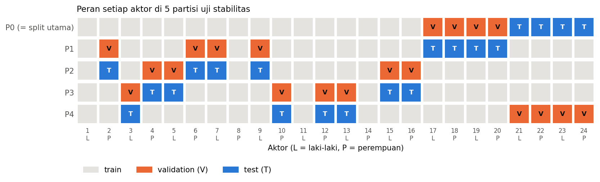

### Verifikasi

Semua 10 pemeriksaan OK:

- Split utama tidak tumpang tindih; ukurannya 16/4/4 aktor dan 960/240/240 file; gender seimbang; 8 emosi lengkap dengan jumlah sesuai (neutral 4, emosi lain 8 per aktor).
- 5 partisi valid (16/4/4 aktor, test dan validation masing-masing 2 L + 2 P); setiap aktor paling banyak sekali test dan sekali validation.
- P0 identik dengan split utama; 1.440 file masuk tepat satu bagian; test = aktor 21–24 sesuai Rencana Kerja; pengundian dengan seed 42 memberi hasil yang sama jika diulang.

### Pemeriksaan 5 file tanpa frame bersuara

| File | Emosi | Split | RMS (dB) | Peluang bernada tertinggi (pengaturan langkah 5) | Frame bernada (pyin longgar) | F0 median (longgar) | Penilaian |
| --- | --- | --- | --- | --- | --- | --- | --- |
| Actor\_03/03-01-07-02-01-01-03.wav | disgust strong | train | −40,2 | 0,37 | 126 (50%) | 146 Hz | Nada ada; pyin dengan pengaturan langkah 5 sedikit di bawah ambang |
| Actor\_09/03-01-04-02-01-02-09.wav | sad strong | train | −53,9 | 0,11 | 14 (5%) | 56 Hz | Sangat pelan; nada (jika ada) di bawah batas 65 Hz |
| Actor\_09/03-01-05-02-01-02-09.wav | angry strong | train | −19,5 | 0,28 | 15 (8%) | 746 Hz | Hasil longgar tidak masuk akal (terlalu tinggi) |
| Actor\_21/03-01-07-02-01-01-21.wav | disgust strong | test | −36,8 | 0,05 | 12 (6%) | 736 Hz | Hasil longgar tidak masuk akal (terlalu tinggi) |
| Actor\_21/03-01-08-02-02-01-21.wav | surprised strong | test | −29,5 | 0,49 | 0 | – | Tidak terdeteksi sama sekali |

Temuan:

- **Kelima file berisi ucapan yang jelas** (lihat bentuk gelombang di bawah). Jadi masalahnya bukan file kosong atau rusak; pyin gagal menemukan nada yang teratur.
- **Kelimanya laki-laki (aktor 3, 9, dan 21) dan semuanya berintensitas strong.** Emosi yang diucapkan dengan kuat sering terdengar serak, kasar, atau berteriak. Getaran pita suaranya jadi tidak teratur, sehingga sulit dibaca sebagai nada.
- **Melonggarkan pengaturan pyin tidak menyelesaikan masalah.** Hanya file aktor 3 yang mendapat nada masuk akal (146 Hz, wajar untuk laki-laki). Tiga file lain mendapat nilai tidak masuk akal (56, 736, dan 746 Hz), dan satu tetap kosong.
- Sebaran: 3 file di train, 2 di test (aktor 21), dan tidak ada di validation.

**Keputusan:** kelima file tetap dipakai dan tabel fitur tidak diubah. Statistik F0-nya tetap 0 dan ditandai oleh `voiced_ratio = 0`. Jumlahnya hanya 0,35%, sedangkan mengubah tabel berarti config\_hash fitur berganti dan baseline B harus diulang.

**Catatan untuk paper (keterbatasan) dan Anggota C (error analysis):** estimasi F0 dengan pyin kurang andal untuk ucapan laki-laki berintensitas kuat. Jika kedua file test dari aktor 21 salah diklasifikasi, F0 = 0 bisa menjadi salah satu penjelasannya.

**Catatan dengar:** tidak dicatat. Penilaian di atas memakai ukuran objektif (bentuk gelombang, peluang bernada, dan hasil pyin longgar). Catatan dengar bersifat opsional dan tidak memengaruhi data maupun keputusan.

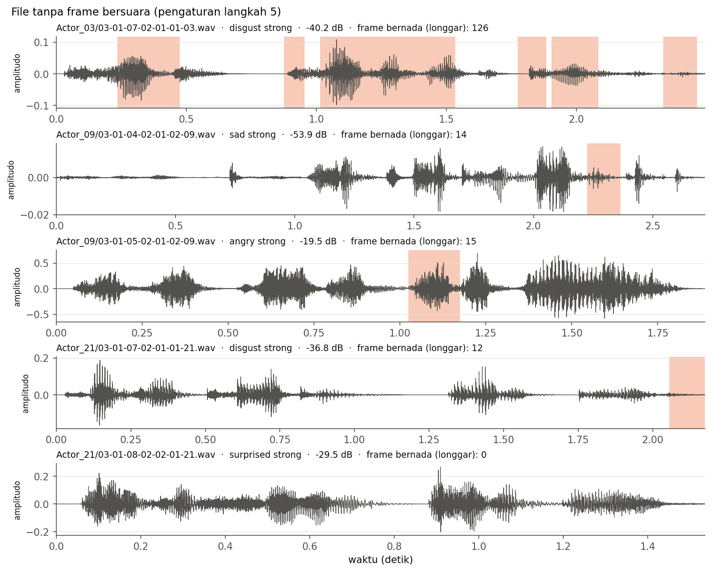

### Tindak lanjut

- Kirim pesan langkah 7 ke Anggota B dan C (lihat bagian Komunikasi).
- Simpan notebook di `project07/notebooks/`.

## Langkah 9 — Test bernoise

### Yang dikerjakan

Notebook `Langkah9_AnggotaA_Test_Bernoise.ipynb` dijalankan pada 22 November 2026 dini hari WIB (tanggal di file 2026-11-21 karena jam Colab memakai UTC). Notebook ini membuat versi bernoise dari test split utama (aktor 21–24, 240 file) untuk failure experiment tambahan. **Tidak ada model yang dilatih atau dievaluasi**, dan label emosi tidak dipakai, jadi aturan "test hanya dipakai sekali oleh Anggota C" tetap terjaga.

| Komponen | Pilihan | Alasan |
| --- | --- | --- |
| Jenis noise | `white` (white noise) dan `esc50` (240 klip ESC-50: rain, wind, vacuum\_cleaner, washing\_machine, engine, keyboard\_typing) | White noise standar dan mudah diulang; ESC-50 mewakili bunyi latar nyata |
| SNR | 20, 10, 0 dB | Sesuai Rencana Kerja: dari noise pelan sampai noise sekeras suara |
| Titik penambahan | Setelah preprocessing (trim), sebelum ekstraksi fitur | SNR dihitung terhadap bagian ucapan saja; efek noise tidak tercampur dengan gagalnya trim |
| Potongan noise | Sama untuk ketiga SNR pada satu file; dipilih deterministik dengan seed 2026 | Perbedaan antar-SNR murni karena keras-pelannya noise |
| Versi | `none` dan `peak` | Versi pilihan baseline B tinggal dipakai |

Output: 12 tabel `data/features/noisy/test_noisy_{white,esc50}_{20,10,0}db_{none,peak}.csv` (masing-masing 240 baris, kolom dan urutan sama dengan tabel bersih), `noisy_log.csv` (sumber noise dan SNR terukur per campuran), `noisy_meta.json`, modul `src/noise.py`, `figures/noisy/` (2 grafik dan `noisy_summary.txt`), serta `docs/README_langkah9_test_bernoise.md`. config\_hash `dcf3a82fad`. Klip ESC-50 disimpan di `data/raw/esc50/` dan tidak di-push.

### Verifikasi

Semua 9 pemeriksaan OK:

- 12 tabel lengkap, masing-masing 240 baris, hanya aktor 21–24, dengan urutan file dan kolom info sama seperti tabel bersih; tidak ada NaN.
- SNR terukur sama persis dengan target (selisih maksimum 0,0000 dB, 1.440 campuran); potongan noise sama untuk ketiga SNR.
- 87 fitur non-energi sama antara versi none dan peak: 99,9992% nilai berada dalam toleransi 0,1%, dan selisih terbesar 0,19% (pembulatan float32, sifat yang sama seperti di langkah 5).
- Ekstraksi ulang 3 contoh acak sama dengan hasil tersimpan; distorsi fitur makin besar saat SNR makin kecil; 240 klip ESC-50 terpakai dari 6 kategori.

### Hasil: seberapa jauh fitur bergeser karena noise

Ukurannya adalah rata-rata selisih fitur bernoise dari fitur bersih, dibagi simpangan baku fitur itu di data train (versi none). Angka 1 berarti fitur bergeser sejauh satu simpangan baku, kira-kira selebar perbedaan antaremosi.

| Kelompok fitur | white 20 dB | white 10 dB | white 0 dB | esc50 20 dB | esc50 10 dB | esc50 0 dB |
| --- | --- | --- | --- | --- | --- | --- |
| mfcc (26) | 0,94 | 1,48 | 1,98 | 0,63 | 1,05 | 1,53 |
| delta\_mfcc (26) | 0,97 | 1,43 | 1,91 | 0,67 | 1,00 | 1,39 |
| prosodi (6) | 0,10 | 0,34 | 1,78 | 0,17 | 0,48 | 1,46 |
| energi (3) | 0,01 | 0,07 | 0,32 | 0,01 | 0,06 | 0,31 |
| zcr (2) | 1,08 | 2,19 | 4,06 | 0,50 | 1,07 | 1,93 |
| spektral (8) | 3,92 | 6,84 | 9,15 | 0,82 | 1,56 | 2,44 |
| contrast (7) | 3,04 | 3,71 | 4,24 | 0,70 | 1,11 | 1,52 |
| chroma (12) | 0,27 | 0,66 | 1,41 | 0,28 | 0,56 | 1,11 |
| **Semua 90 fitur** | **1,20** | **1,90** | **2,67** | **0,56** | **0,95** | **1,48** |

File tanpa frame bersuara (nada tidak terdeteksi), dari 240 file test:

| Kondisi | bersih | 20 dB | 10 dB | 0 dB |
| --- | --- | --- | --- | --- |
| white | 2 | 2 | 14 | 134 |
| esc50 | 2 | 1 | 11 | 64 |

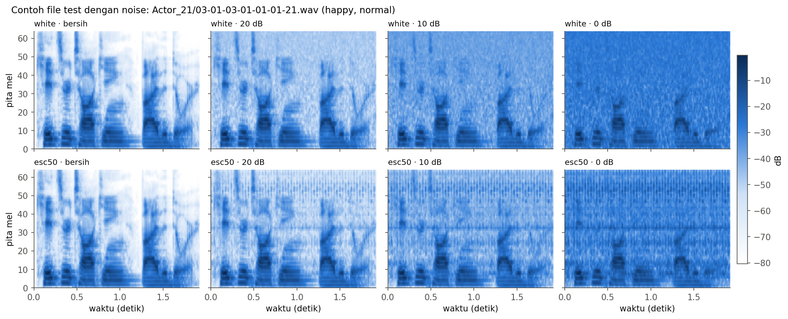

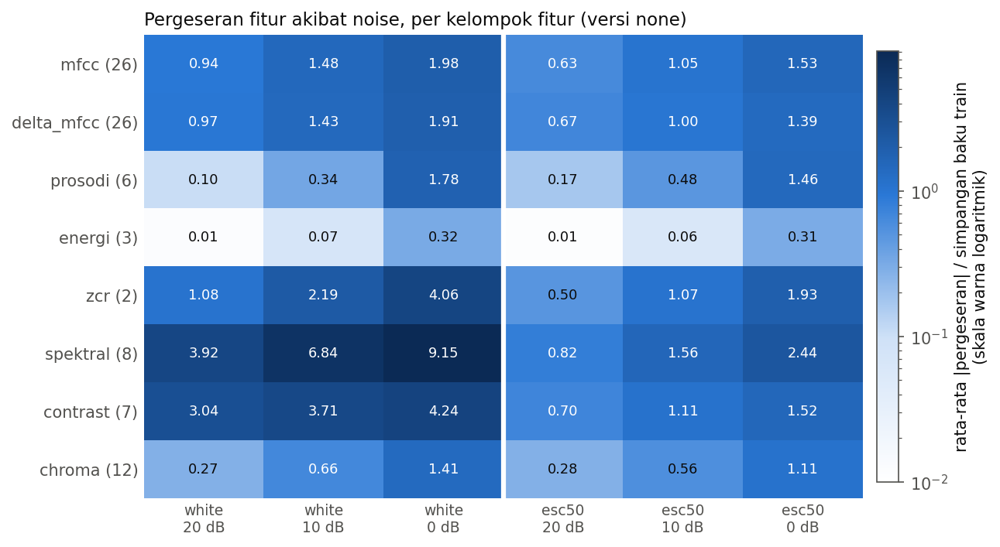

### Temuan

1. **White noise jauh lebih merusak daripada noise ruangan pada SNR yang sama** (rata-rata 2,67 vs 1,48 pada 0 dB). White noise menyebar ke semua frekuensi, termasuk frekuensi tinggi tempat suara bicara lemah. Sebagian besar noise ruangan ESC-50 (mesin, mesin cuci, angin) terkumpul di frekuensi rendah.
2. **Fitur bentuk spektrum paling rapuh.** Spectral flatness, rolloff, bandwidth, contrast pita tertinggi, dan ZCR bergeser paling jauh. Pada white 0 dB, `flatness_mean` bergeser 31,7 simpangan baku, karena white noise membuat spektrum menjadi rata. Bahkan pada white 20 dB (noise pelan), kelompok spektral sudah bergeser 3,9 simpangan baku.
3. **Fitur energi dan MFCC orde rendah paling tahan.** `rms_max`, `rms_std`, `rms_mean`, `mfcc02_mean`, dan `mfcc04_mean` bergeser paling sedikit. Ini wajar: SNR dihitung terhadap daya ucapan, jadi pada 20 dB noise hanya menambah sekitar 1% daya.
4. **Fitur nada (prosodi) tahan pada noise pelan, tetapi runtuh pada 0 dB.** Pada 20 dB pergeserannya hanya 0,10–0,17, sedangkan pada white 0 dB nada tidak terdeteksi di 134 dari 240 file (56%). Dua file "bersih" tanpa nada adalah file aktor 21 yang sudah dicatat di langkah 7.

**Hipotesis untuk Anggota C dan research seed:** subset hasil SA yang banyak memakai fitur bentuk spektrum dan ZCR kemungkinan turun paling tajam di data bernoise, sedangkan subset yang bertumpu pada MFCC dan energi kemungkinan lebih tahan. Ini membuka ide objective SA yang ikut mempertimbangkan ketahanan terhadap noise. Pergeseran fitur belum sama dengan turunnya akurasi; buktinya tetap menunggu evaluasi model oleh C.

### Tindak lanjut

- Kirim pesan langkah 9 ke Anggota C (lihat bagian Komunikasi).
- Simpan notebook di `project07/notebooks/`.

## Langkah 10 — Pembanding mutual information

### Yang dikerjakan

Notebook `Langkah10_AnggotaA_Mutual_Information.ipynb` dijalankan pada 24 November 2026 (config\_hash `eccc001f3d`, fitur `0c3114fc78`). Pembanding *filter method* untuk SA: 52 fitur dengan mutual information tertinggi terhadap label emosi, dihitung hanya di data train.

1. Versi tabel fitur `peak`, yang terpilih di baseline Anggota B (SVM val macro F1 0,5165 vs 0,4846).
2. k = 52, sama dengan subset SA utama Anggota B (P0, seed 42; median 3 seed = 52).
3. Data: train split utama, aktor 1–16 (960 baris).
4. Estimator `mutual_info_classif`, `n_neighbors=3`, rata-rata 10 seed (scikit-learn 1.6.1).

Output: `data/analysis/mi_scores_peak.csv` (skor, peringkat, kolom `in_top_k`), `data/analysis/mi_eval_preview_peak.csv`, `figures/mutual_info/` (2 grafik dan `mi_summary.txt`), parameter di `config.json` bagian `mutual_info`, dan `docs/README_langkah10_mutual_information.md`.

### Hasil

- Top-52 identik untuk semua seed estimator (Jaccard minimum 1,000).
- Per kelompok: mfcc 17/26, delta\_mfcc 10/26, prosodi 6/6, energi 0/3, zcr 0/2, spektral 6/8, contrast 6/7, chroma 7/12.
- Ketiga fitur energi berperingkat rendah (rms\_mean #79, rms\_std #68, rms\_max #72), jadi hipotesis di langkah 11 bahwa MI akan memilih ketiganya sekaligus **tidak terbukti** untuk energi.
- Redundansi: top-52 mencakup 39 kelompok redundan, dengan 13 fitur kembaran.

Pratinjau di validation (protokol Anggota B; bukan angka resmi paper):

| Subset | k | Val macro F1 (SVM tetap) | CV macro F1 train (tuning) | Val macro F1 (tuning) | Parameter terbaik |
| --- | --- | --- | --- | --- | --- |
| Semua 90 fitur | 90 | 0,5144 | 0,4901 | 0,5165 | C=1, gamma=0,005, RBF |
| MI top-52 | 52 | 0,4658 | 0,4818 | 0,4205 | C=0,01, linear |

Sebagai pembanding, SA-52 Anggota B di validation: 0,4995.

### Verifikasi

7/7 pemeriksaan OK: MI hanya di train (960 × 90); data test tidak dipakai; skor lengkap tanpa NaN dan tidak negatif; 52 indeks unik di rentang 0–89; top-52 stabil terhadap seed (Jaccard min 1,000); file untuk B tersimpan; format mengikuti kontrak `subsets.json`.

### Tindak lanjut

- File `data/analysis/mi_topk_peak.json` (daftar 52 indeks untuk Anggota B) disebut di README langkah 10 tetapi belum ada di repo. Sementara itu, daftar yang sama bisa diambil dari `mi_scores_peak.csv` (baris dengan `in_top_k = True`, kolom `index`).
- Kolom `in_sa_subset` di `mi_scores_peak.csv` masih kosong; isi dari subset SA utama Anggota B.
- Anggota B melatih SVM final MI-52 di train + validation; Anggota C mengevaluasinya sekali di test.

## Langkah 11 — Analisis korelasi fitur

### Yang dikerjakan

Notebook `Langkah11_AnggotaA_Korelasi_Fitur.ipynb` dijalankan pada 22 November 2026 dini hari WIB (tanggal di file 2026-11-21 karena jam Colab memakai UTC). Sesuai Rencana Kerja, hanya data train yang dipakai (aktor 1–16, 960 baris), tanpa label emosi.

1. Matriks korelasi Pearson 90 × 90 untuk versi none dan peak.
2. Daftar pasangan fitur dengan |r| > 0,8.
3. Kelompok fitur redundan dengan hierarchical clustering (jarak = 1 − |r|, average linkage, dipotong di jarak 0,2). Setiap kelompok diberi satu fitur wakil, yaitu anggota dengan rata-rata |r| tertinggi ke anggota lainnya.
4. Modul `src/redundancy.py` (`jaccard`, `cluster_jaccard`, `mean_pairwise`), supaya Anggota C bisa mengukur kestabilan SA per fitur dan per kelompok redundan.
5. Korelasi Spearman sebagai pembanding.

Output: `data/analysis/corr_pearson_train_{none,peak}.csv`, `corr_pairs_r08_{none,peak}.csv`, `corr_clusters_{none,peak}.csv`, `src/redundancy.py`, `figures/correlation/` (2 grafik dan `correlation_summary.txt`), serta `docs/README_langkah11_korelasi.md`. config\_hash `63bc4a61b4`.

### Hasil

| Ukuran | Versi none |
| --- | --- |
| Pasangan \|r\| > 0,8 | 39 dari 4.005 pasangan (1%): 28 dalam kelompok fitur yang sama, 11 antarkelompok |
| Fitur yang punya minimal satu pasangan | 45 dari 90 |
| Kelompok redundan | 66 kelompok: 17 kelompok berisi ≥ 2 fitur (total 41 fitur), 49 fitur berdiri sendiri |
| Spearman \|r\| > 0,8 | 37 pasangan, 36 di antaranya sama dengan Pearson |
| Versi peak | 36 pasangan; berbeda dari none hanya pada korelasi yang melibatkan fitur energi |

Kelompok redundan berisi ≥ 2 fitur (wakil dicetak tebal):

| Kelompok | Anggota | Informasi yang dibawa |
| --- | --- | --- |
| K1 | mfcc12\_std, mfcc13\_std, dmfcc12\_std, **dmfcc13\_std** | Variasi warna suara orde tinggi dan laju perubahannya |
| K2 | **f0\_mean**, f0\_p05, f0\_p95 | Tinggi nada rata-rata |
| K3 | rms\_mean, **rms\_std**, rms\_max | Keras-pelan suara (r = 0,96–0,99) |
| K4 | zcr\_mean, **centroid\_mean**, rolloff\_mean | Terang atau tajamnya suara |
| K5 | zcr\_std, **centroid\_std**, rolloff\_std | Variasi terang-tajamnya suara |
| K6 | **contrast4\_mean**, contrast5\_mean, contrast6\_mean | Kontras spektrum pita tengah-atas |
| K7–K10 | mfccN\_std dan dmfccN\_std untuk N = 2, 4, 10, 11 (wakil: versi mfcc) | Variasi MFCC dan laju perubahannya |
| K11 | **f0\_std**, f0\_range | Lebar intonasi (r = 0,97) |
| K12 | **flatness\_mean**, flatness\_std | Kerataan spektrum |
| K13–K17 | Chroma bertetangga: 01–12, 02–03, 04–05, 07–08, 10–11 (wakil: nomor terkecil) | Kelas nada yang bersebelahan |

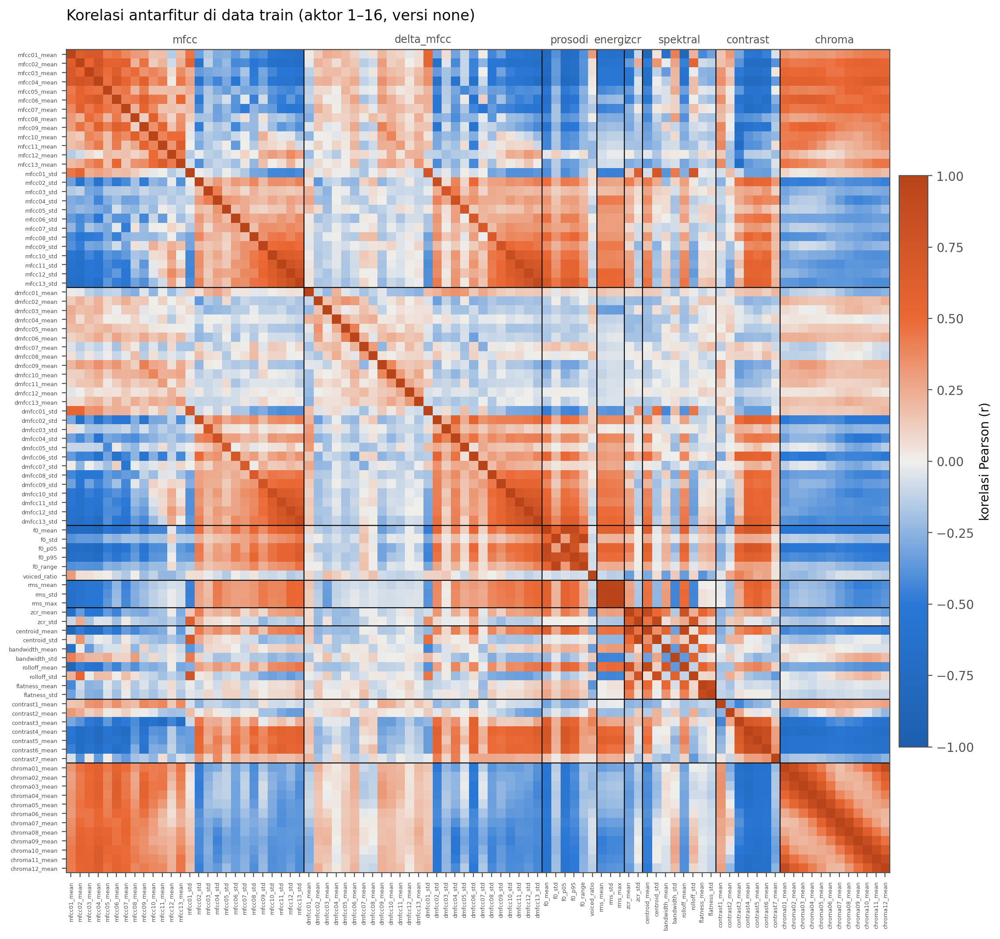

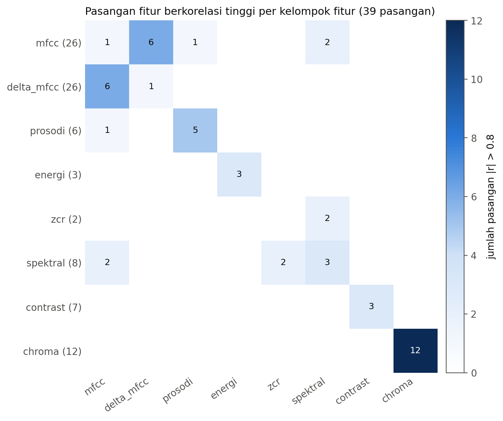

### Verifikasi

7 dari 8 pemeriksaan OK, dan 1 CEK sudah dijelaskan; hasilnya tidak salah.

- OK: hanya data train (960 baris); matriks simetris, diagonal 1, tanpa NaN; setiap fitur masuk tepat satu kelompok; rata-rata |r| setiap anggota ke kelompoknya ≥ 0,8 (minimum 0,807); none dan peak hanya berbeda di fitur energi; Spearman konsisten (36 dari 39 pasangan sama); uji modul 4/4.
- **CEK: hanya 69% pasangan |r| > 0,8 (27 dari 39) yang berada dalam satu kelompok redundan.** Angka batas 80% di pemeriksaan ini adalah perkiraan saya sebelum melihat data, bukan aturan baku. Sisanya terjadi karena beberapa fitur berkorelasi **berantai**, terutama chroma. Kelas nada yang bersebelahan saling berkorelasi (01\~02, 02\~03, 03\~04, …, 12\~01, melingkar seperti lingkaran nada), tetapi kelas nada yang berjauhan tidak. Average linkage hanya menggabungkan fitur yang rata-rata korelasinya ke semua anggota kelompok ≥ 0,8, sehingga rantai itu terpecah menjadi pasangan-pasangan kecil (K13–K17). Contohnya, chroma03 dan chroma04 berkorelasi tinggi, tetapi berada di K14 dan K15. Dari 12 pasangan chroma, hanya 5 yang berada dalam satu kelompok. Pola serupa terjadi sedikit di MFCC std. Ini sifat data, bukan kesalahan perhitungan. Konsekuensinya, Jaccard per kelompok yang dihitung C sedikit konservatif (cenderung meremehkan kestabilan).

### Temuan

1. **Redundansi nyata tetapi terbatas.** Hanya 1% pasangan yang berkorelasi sangat tinggi. Secara informasi, 90 fitur setara dengan sekitar 66 kelompok.
2. **Tiga fitur energi hampir identik** (r = 0,96–0,99), demikian pula `f0_std` dan `f0_range` (0,97). Untuk SA, memilih salah satu anggota kelompok seperti ini hampir sama dengan memilih semuanya.
3. **Fitur "terang suara" dari kelompok berbeda ternyata saling menggantikan.** ZCR, spectral centroid, dan rolloff (K4 dan K5) masuk ke satu kelompok walaupun berasal dari kelompok fitur yang berbeda.
4. **Di luar pasangan > 0,8, matriks memperlihatkan dua blok besar yang saling berlawanan** dengan korelasi sedang (sekitar 0,4–0,7): (a) MFCC mean dan chroma, (b) variasi MFCC, delta std, prosodi, energi, dan contrast 3–6. Banyak fitur tampaknya bergerak bersama satu faktor umum, kemungkinan berkaitan dengan upaya vokal atau keterbangkitan emosi. Ini masih dugaan dan belum diuji.

**Implikasi:**

- **Untuk Anggota C (analisis stabilitas):** Jaccard per fitur antar-run SA kemungkinan rendah, sedangkan Jaccard per kelompok (`rd.cluster_jaccard`) lebih tinggi. Jika benar, SA sebenarnya konsisten dan hanya bergantian memilih fitur yang saling menggantikan. Inilah penjelasan untuk "subset tampak tidak stabil tetapi performanya sama".
- **Untuk langkah 10 (mutual information) dan paper:** mutual information menilai fitur satu per satu, sehingga top-k MI kemungkinan memilih beberapa anggota satu kelompok sekaligus (misalnya ketiga fitur energi). Itu boros, sedangkan SA menilai kombinasi dan bisa menghindarinya. Hipotesis ini diperiksa saat langkah 10.

### Tindak lanjut

- Kirim pesan langkah 11 ke Anggota C (lihat bagian Komunikasi).
- Simpan notebook di `project07/notebooks/`.

## Langkah 12 — Mini-eksperimen MLP: fitur lengkap vs terpilih

### Yang dikerjakan

Notebook `Langkah12_AnggotaA_MLP.ipynb` dijalankan pada 24 November 2026 (config\_hash `d03ab6d497`). Mini-eksperimen deep learning Minggu 12: MLP 2 hidden layer pada 90 fitur, SA-52, dan MI-52, dengan split dan metrik yang sama.

1. Data `features_peak.csv`. Tuning di train (aktor 1–16) dengan `GridSearchCV` + `GroupKFold(4)` per aktor; grid layer {(64, 32), (128, 64), (256, 128)} × alpha {0,001; 0,01; 0,1; 1; 3}.
2. MLP: ReLU, Adam (learning rate 0,001), early stopping (15% data latih, 20 epoch tanpa perbaikan), maksimum 1.000 epoch.
3. Penilaian: macro F1 validation (aktor 17–20), rata-rata ± simpangan baku 5 seed. Pembanding SVM RBF (C = 1, gamma = scale, class\_weight = balanced).
4. Model final dilatih ulang di train + validation (aktor 1–20) dengan seed 0. Data test tidak dipakai.

Output: `results/mlp_results.json`, `results/mlp_summary.csv`, `results/mlp_summary.txt`, `models/mlp_full90.joblib`, `mlp_sa52.joblib`, `mlp_mi52.joblib`, `figures/mlp/`, dan `docs/README_langkah12_mlp.md`.

### Hasil (validation)

| Subset | k | Layer, alpha | CV macro F1 train | Val macro F1 MLP (5 seed) | Val UAR MLP | Val macro F1 SVM |
| --- | --- | --- | --- | --- | --- | --- |
| Semua 90 fitur | 90 | (256, 128), 1,0 | 0,4682 | 0,4769 ± 0,0261 | 0,4719 | 0,5144 |
| SA (52 fitur) | 52 | (256, 128), 0,01 | 0,4639 | 0,4771 ± 0,0244 | 0,4766 | 0,4995 |
| MI top-52 | 52 | (128, 64), 0,01 | 0,4634 | 0,4523 ± 0,0284 | 0,4500 | 0,4658 |

MLP tidak lebih baik daripada SVM di ketiga subset. Pada MLP, SA-52 setara dengan 90 fitur, sedangkan MI-52 sekitar 0,025 lebih rendah.

### Verifikasi

7/7 pemeriksaan OK: tuning hanya di train; lipatan GroupKFold memisahkan aktor; data test tidak dipakai; model final di aktor 1–20 (1.200 baris); setiap subset 5 seed; 3 model bisa dimuat dan memprediksi label 0–7; SVM pembanding mereproduksi angka langkah 10 dan Anggota B (0,5144 dan 0,4995).

### Keterbatasan

- `MLPClassifier` tidak mendukung bobot kelas, sehingga kelas neutral tidak diberi bobot tambahan seperti pada SVM.
- Early stopping menyisihkan 15% data latih secara acak (bukan per aktor), sehingga penghentiannya sedikit optimis.
- Bundle model MLP belum mencatat `train_val_actors` dan `n_features`, berbeda dari bundle Anggota B.

## Mini-eksperimen Minggu 6 (KMP) dan Minggu 9–10 (fuzzy)

Dijalankan pada 24 November 2026 dengan notebook `MiniEksperimen_AnggotaA_KMP_Fuzzy.ipynb`. Hanya data train dan validation yang dipakai. Rincian ada di `docs/README_mini_eksperimen_A.md`, `results/mini_eksperimen_A.json`, dan `figures/mini/`.

- **KMP pada kontur F0** (aktor 1 dan 2, kalimat 1, 60 file): pola 4 token (200 ms) hanya ditemukan persis pada 40% pengulangan dengan emosi yang sama dan 28% dengan emosi berbeda; pola 12 token 0%. Ucapan tidak pernah persis sama, jadi pencocokan persis tidak berguna untuk emosi. **Tidak dipakai** di metode final.
- **Fuzzy rule arousal** (F0 mean dan RMS dB, 9 aturan): akurasi biner arousal di validation 0,774 dengan batas F0 per gender (0,755 tanpa gender). Tidak bisa membedakan emosi dengan arousal serupa. **Tidak dipakai** sebagai fitur; opsional sebagai indikator arousal di demo Anggota C.
- Verifikasi 8/8 OK.

## Komunikasi dengan anggota lain

Pesan untuk Anggota B dan Anggota C disiapkan pada 21 November 2026. Pesan ke B berisi konfirmasi preprocessing; lampirannya grafik `figures/preprocess/pre_03_energi_none_vs_peak.png` dan link Log Kerja ini (dokumen perlu dibagikan dulu ke B).

| Tanggal | Kepada | Isi | Status |
| --- | --- | --- | --- |
| 21 November 2026 | Anggota B | Status preprocessing, 4 keputusan yang perlu dikonfirmasi, tabel rentang energi, permintaan baseline dua versi | Disiapkan; tanggal dikirim: … |
| 21 November 2026 | Anggota C | Lokasi gambar EDA untuk paper, modul `src/preprocess.py` untuk demo beserta contoh kode, link Dataset Card dan Log Kerja | Disiapkan; tanggal dikirim: … |
| 22 November 2026 | Anggota B | Tabel fitur siap (lokasi, cara memuat, catatan penting), permintaan baseline none vs peak | Disiapkan; tanggal dikirim: … |
| 22 November 2026 | Anggota C | Modul `src/features.py` untuk demo beserta contoh kode (diuji), grafik fitur untuk paper | Disiapkan; tanggal dikirim: … |
| 22 November 2026 | Anggota B | splits.json, partitions.json, dan src/data\_splits.py siap (cara pakai, catatan GroupKFold, P0 = split utama), permintaan hasil baseline | Disiapkan; tanggal dikirim: … |
| 22 November 2026 | Anggota C | Split utama (test aktor 21–24), partisi untuk analisis stabilitas beserta Jaccard 0,46, 2 file test tanpa nada untuk error analysis | Disiapkan; tanggal dikirim: … |
| 22 November 2026 | Anggota C | 12 tabel test bernoise siap (lokasi, cara pakai, protokol evaluasi), temuan pergeseran fitur dan hipotesis | Disiapkan; tanggal dikirim: … |
| 22 November 2026 | Anggota C | Hasil analisis korelasi, 17 kelompok redundan, modul src/redundancy.py untuk Jaccard per kelompok | Disiapkan; tanggal dikirim: … |

**Pesan ke Anggota B**

**Konfirmasi dari Anggota B** (isi setelah dibalas)

| Poin | Isi | Jawaban B |
| --- | --- | --- |
| 2a | Mono + resample 16 kHz |  |
| 2b | Trim hening `top_db=30` |  |
| 2c | Ekstraksi dua versi; B menjalankan baseline keduanya dan memilih dengan macro F1 validation |  |
| 2d | 18 file clipping tetap dipakai |  |

**Isi pesan yang dikirim**

> Halo B, ini update dari aku (Anggota A) soal preprocessing, sekalian minta konfirmasi beberapa hal sebelum aku ekstrak fitur.
>
> **1. Status**
>
> - Preprocessing 1.440 file sudah selesai (mono, 16 kHz, trim hening top\_db=30). Semua 8 pemeriksaan verifikasi OK.
> - Parameter: `project07/config.json`
> - Modul preprocessing: `project07/src/preprocess.py`
> - Dokumentasi: `project07/docs/README_langkah4_preprocessing.md`
>
> **2. Keputusan yang perlu kamu konfirmasi**
>
> - a. Mono + resample ke 16 kHz: tetap sesuai rencana.
> - b. Trim hening top\_db=30: tetap. Di EDA terbukti konsisten memotong jeda ±1 detik di awal dan akhir file.
> - c. Normalisasi amplitudo: aku ekstrak fitur dua versi, yaitu tanpa normalisasi (`features_none.csv`) dan normalisasi puncak (`features_peak.csv`). Tolong jalankan baseline (semua fitur + SVM) untuk dua-duanya, lalu pilih yang macro F1-nya lebih tinggi di data VALIDATION (bukan test).
> - d. 18 file clipping: tetap dipakai. 17 di antaranya angry strong (aktornya berteriak), jadi itu bagian dari emosinya. Kalau dibuang, kelas angry kehilangan contoh yang paling keras.
>
> **3. Kenapa normalisasi perlu dibandingkan** (lihat grafik pre\_03 terlampir)
>
> Rentang energi (selisih median yang terkeras dan terpelan):
>
> - Tanpa normalisasi: antaremosi 19,3 dB, antaraktor 18,5 dB
> - Normalisasi puncak: antaremosi 1,2 dB, antaraktor 4,5 dB
>
> Artinya normalisasi puncak menghapus hampir semua beda keras-pelan antaremosi (turun 94%), tapi juga sebagian besar beda antaraktor (turun 76%). Yang terpengaruh cuma fitur berbasis level suara (energi RMS dan MFCC ke-0). MFCC lainnya, F0, ZCR, dan fitur spektral tidak berubah. Jadi perbandingan di baseline menjawab satu pertanyaan: informasi keras-pelan ini membantu atau malah merugikan waktu model diuji ke speaker yang belum pernah didengar?
>
> **4. Yang aku butuhkan dari kamu**
>
> - Konfirmasi poin 2a sampai 2d (cukup balas "ok semua" atau sebutkan yang mau diubah).
> - Setelah `features_none.csv` dan `features_peak.csv` jadi di langkah 5, jalankan baseline untuk keduanya.
>
> Detail lengkap ada di Log Kerja Anggota A: \[link Log Kerja\]
>
> Terima kasih!

**Pesan ke Anggota C**

Alasan: sesuai tabel dependensi di rencana kerja, Anggota A menyerahkan gambar EDA untuk mini-paper dan fungsi pemrosesan audio untuk demo kepada Anggota C. Contoh kode di pesan sudah diuji untuk audio mono dan stereo.

**Konfirmasi dari Anggota C** (isi setelah dibalas)

| Poin | Isi | Jawaban C |
| --- | --- | --- |
| 4a | Format gambar (PNG 200 dpi, judul bahasa Indonesia) cocok untuk paper |  |
| 4b | Demo memakai `src/preprocess.py` |  |

**Isi pesan yang dikirim**

> Halo C, ini update dari aku (Anggota A). Ada beberapa hasil yang nanti kamu pakai untuk paper dan demo.
>
> **1. Gambar EDA untuk mini-paper**
>
> Sudah ada di `project07/figures/eda/` (PNG 200 dpi):
>
> - `eda_01_distribusi_kelas.png`
> - `eda_02_durasi.png`, `eda_03_durasi_per_emosi.png`
> - `eda_04_contoh_aktor01.png`, `eda_05_contoh_aktor02.png` (waveform + mel-spectrogram tiap emosi)
> - `eda_06_energi_per_emosi.png`
> - `eda_07_hening_dan_puncak.png`, `eda_08_cek_trim.png`
> - `eda_summary.txt` (angka-angka ringkasannya)
>
> Grafik preprocessing ada di `project07/figures/preprocess/`.
>
> **2. Modul preprocessing untuk demo**
>
> `project07/src/preprocess.py` sudah siap. Tolong pakai modul ini di demo supaya rekaman pengguna diproses persis sama dengan data latih (mono, 16 kHz, trim hening). Contoh:
>
> ```python
> import sys
> sys.path.insert(0, '/content/drive/MyDrive/project07/src')
> import preprocess as pp
> # audio dari Gradio (numpy): sr, data dengan data int16 berbentuk (n,) atau (n, channel)
> y = data.T.astype('float32') / 32768
> y_out, info = pp.preprocess_signal(y, sr, normalize_method='none')
> ```
>
> Normalisasi (`'none'` atau `'peak'`) nanti ikut versi yang dipilih B dari baseline. Panduan lengkap ada di `project07/docs/README_langkah4_preprocessing.md`, bagian "Cara memakai modul". Fungsi ekstraksi fitur untuk demo menyusul di langkah 5 (`src/features.py`).
>
> **3. Dokumen pendukung**
>
> - Dataset Card: \[link Dataset Card\]
> - Log Kerja Anggota A: \[link Log Kerja\]
>
> Isinya bisa langsung dipakai untuk bagian Dataset dan Preprocessing di paper.
>
> **4. Yang aku butuhkan dari kamu**
>
> - a. Apakah format gambar (PNG 200 dpi, judul bahasa Indonesia) sudah cocok untuk paper, atau perlu diubah (misalnya judul bahasa Inggris)?
> - b. Konfirmasi demo akan memakai `src/preprocess.py`.
>
> Catatan: `splits.json` (pembagian aktor train/validation/test) menyusul di langkah 7. Data test tetap hanya kamu yang memakai, di akhir.
>
> Terima kasih!

**Pesan langkah 5 ke Anggota B (22 November 2026)**

> Halo B, tabel fitur sudah siap untuk baseline.
>
> **1. File** (di `project07/data/features/`)
>
> - `features_none.csv`: tanpa normalisasi
> - `features_peak.csv`: normalisasi puncak
> - `feature_names.csv`: index, nama, kelompok, deskripsi, dan apakah fitur bergantung volume
>
> Masing-masing 1.440 baris: 5 kolom info (file, actor, gender, emotion, intensity) + 90 fitur. Semua 9 pemeriksaan verifikasi OK.
>
> **2. Cara memuat**
>
> ```python
> import pandas as pd
> fn = pd.read_csv('.../data/features/features_none.csv')
> names = pd.read_csv('.../data/features/feature_names.csv')
> X = fn[names['name']].values      # 1440 x 90
> y = fn['emotion'].values
> groups = fn['actor'].values       # untuk split per aktor / GroupKFold
> ```
>
> **3. Catatan penting**
>
> - Fitur BELUM distandardisasi. `StandardScaler` taruh di dalam Pipeline dan fit di train saja.
> - Bedanya none vs peak cuma di 3 fitur energi (`rms_mean`, `rms_std`, `rms_max`). 87 fitur lainnya identik. MFCC ke-0 sengaja tidak dipakai supaya perbandingannya bersih.
> - 5 file tidak punya frame bersuara (`voiced_ratio` = 0). Fitur F0-nya diisi 0, bukan kosong. Aku periksa file mana saja di langkah berikutnya.
> - `splits.json` menyusul (langkah 7), sesuai rencana: aktor 1–16 train, 17–20 validation, 21–24 test. Sambil menunggu, tolong jangan pakai aktor 21–24 sama sekali.
>
> **4. Yang aku butuhkan**
>
> - Jalankan baseline (semua fitur + SVM, tuning GroupKFold per aktor di train) untuk `features_none.csv` dan `features_peak.csv`, lalu kabari macro F1 validation keduanya supaya kita bisa putuskan normalisasinya.
> - Konfirmasi poin 2a–2d dari pesanku sebelumnya kalau belum.
>
> Dokumentasi lengkap: `project07/docs/README_langkah5_ekstraksi_fitur.md`
>
> Terima kasih!

**Hasil baseline dari Anggota B** (isi setelah dibalas)

| Versi | Macro F1 validation | Catatan |
| --- | --- | --- |
| `none` |  |  |
| `peak` |  |  |

**Pesan langkah 5 ke Anggota C (22 November 2026)**

> Halo C, update lanjutan dari aku (Anggota A).
>
> **1. Modul fitur untuk demo**
>
> `project07/src/features.py` sudah siap. Untuk rekaman baru di demo, urutannya preprocessing dulu, lalu ekstraksi fitur:
>
> ```python
> import sys
> sys.path.insert(0, '/content/drive/MyDrive/project07/src')
> import preprocess as pp, features as ft
> y = data.T.astype('float32') / 32768            # audio dari Gradio
> y_pre, info = pp.preprocess_signal(y, sr, normalize_method='none')
> x = ft.extract_features(y_pre)                   # 90 angka, urutan = ft.FEATURE_NAMES
> ```
>
> Normalisasi (`'none'` atau `'peak'`) ikut versi yang dipilih dari baseline B. Model nanti cukup memakai kolom fitur yang dipilih simulated annealing dari `x`.
>
> **2. Grafik untuk paper** (di `project07/figures/features/`)
>
> - `feat_01_f0_per_emosi_gender.png`: nada dasar per emosi dan gender
> - `feat_02_profil_fitur_per_emosi.png`: profil 90 fitur per emosi (heatmap)
> - `features_summary.txt`: angka ringkasannya
>
> Keduanya hanya memakai aktor 1–16 (rencana train), jadi data validation dan test tidak tersentuh.
>
> **3. Dokumentasi:** `project07/docs/README_langkah5_ekstraksi_fitur.md`, bagian "Cara memakai".
>
> Kalau ada kebutuhan format lain untuk demo atau paper, kabari aku ya. Terima kasih!

Contoh kode untuk C diuji pada 22 November 2026: audio stereo 44,1 kHz bergaya Gradio menghasilkan 90 fitur tanpa NaN.

### Pesan langkah 7 ke Anggota B (22 November 2026)

Halo B, split data sudah siap, jadi baseline final bisa langsung pakai pembagian resmi.

1. File

- `project07/data/splits.json`: train aktor 1–16 (960 file), validation 17–20 (240 file), test 21–24 (240 file). Gender seimbang, 8 emosi lengkap, 10/10 verifikasi OK.
- `project07/data/partitions.json`: 5 partisi (P0–P4) untuk 15 run stabilitas di Minggu 13.
- `project07/src/data_splits.py`: fungsi pembaca split.

2. Cara pakai

```python
import sys
sys.path.insert(0, '/content/drive/MyDrive/project07/src')
import data_splits as ds
import pandas as pd

BASE_DIR = '/content/drive/MyDrive/project07'
fn = pd.read_csv(BASE_DIR + '/data/features/features_none.csv')
names = pd.read_csv(BASE_DIR + '/data/features/feature_names.csv')

tr, va, te = ds.split_frames(fn, ds.load_splits(BASE_DIR))
X_tr = tr[names['name']].values
y_tr = tr['emotion'].values
g_tr = tr['actor'].values   # groups untuk GroupKFold
X_va = va[names['name']].values
y_va = va['emotion'].values
# te jangan dipakai: hanya untuk C di evaluasi akhir
```

3. Catatan

- Tuning pakai GroupKFold(n\_splits=4) dengan groups=g\_tr, di train saja. Pilih none vs peak dari macro F1 validation.
- P0 di partitions.json sama persis dengan split utama, jadi run SA utama kamu langsung terhitung sebagai P0. Untuk uji stabilitas tinggal tambah P1–P4 × 3 seed; isi kolom partition di subsets.json dengan "P0" sampai "P4".
- 5 file tanpa nada (voiced\_ratio = 0) tetap dipakai; semuanya laki-laki dengan intensitas strong. Tidak perlu tindakan apa pun.

4. Yang aku butuhkan

- Kabari macro F1 validation baseline none vs peak (SVM dan RF) kalau sudah.
- Kalau format partitions.json kurang cocok untuk skrip SA kamu, kabari sebelum Minggu 13.

Dokumentasi: `project07/docs/README_langkah7_split_partisi.md`. Terima kasih!

### Pesan langkah 7 ke Anggota C (22 November 2026)

Halo C, update langkah 7 dari aku (Anggota A).

1. Split utama: `project07/data/splits.json`. Test = aktor 21–24 (240 file, 2 L + 2 P). Sesuai rencana, test hanya kamu yang pakai, sekali di evaluasi akhir. Untuk evaluate.py bisa pakai modul `src/data_splits.py`:

```python
import data_splits as ds
tr, va, te = ds.split_frames(fn, ds.load_splits(BASE_DIR))
parts = ds.load_partitions(BASE_DIR)   # P0..P4
```

2. Partisi untuk analisis stabilitas: `project07/data/partitions.json` (P0–P4; P0 = split utama). Grafik peran aktor per partisi: `figures/splits/split_01_partisi_aktor.png`. Catatan penting: aktor train antarpartisi saling berbagi sekitar separuh (Jaccard rata-rata 0,46, rentang 0,33–0,60). Jadi kemiripan subset SA antarpartisi perlu dibandingkan dengan angka ini, bukan dengan nol.
3. Untuk error analysis dan bagian keterbatasan: 5 file tidak punya nada terdeteksi (F0 = 0), semuanya laki-laki dengan intensitas strong. Dua di antaranya ada di test: `Actor_21/03-01-07-02-01-01-21.wav` (disgust) dan `Actor_21/03-01-08-02-02-01-21.wav` (surprised). Daftar lengkap ada di `data/unvoiced_check.csv`, grafiknya di `figures/splits/split_02_file_tanpa_nada.png`.
4. Dokumentasi: `docs/README_langkah7_split_partisi.md`. Kalau format file kurang cocok untuk evaluate.py, kabari ya. Terima kasih!

### Pesan langkah 9 ke Anggota C (22 November 2026)

Halo C, data test bernoise untuk failure experiment tambahan (Minggu 12–13) sudah siap.

1. File (di `project07/data/features/noisy/`): `test_noisy_{white|esc50}_{20|10|0}db_{none|peak}.csv`, total 12 tabel. Masing-masing 240 baris (aktor 21–24) dengan kolom dan urutan baris sama persis dengan test bersih. Pakai versi (none atau peak) yang sama dengan pilihan baseline B.
2. Cara pakai:

```python
import pandas as pd
names = pd.read_csv(BASE_DIR + '/data/features/feature_names.csv')
te_noisy = pd.read_csv(BASE_DIR + '/data/features/noisy/test_noisy_esc50_10db_none.csv')
X_te_noisy = te_noisy[names['name']].values
y_te = te_noisy['emotion'].values
```

3. Usulan protokol: model dilatih di train bersih dan dipilih di validation bersih, lalu dievaluasi sekali di test bersih ditambah 6 kondisi noise (2 jenis × 3 SNR). Bandingkan semua fitur, subset SA, dan top-k mutual information.
4. Temuan awal dari sisi fitur (tanpa model dan tanpa label): white noise jauh lebih merusak daripada noise ruangan. Fitur bentuk spektrum, contrast, dan ZCR paling bergeser, sedangkan energi dan MFCC orde rendah paling tahan. Pada 0 dB, nada tidak terdeteksi di 134 dari 240 file (white) dan 64 file (ESC-50). Hipotesisnya: subset SA yang banyak memakai fitur spektral akan turun paling tajam.
5. Grafik untuk paper: `figures/noisy/noisy_01_spektrogram.png` dan `noisy_02_distorsi_fitur.png`. Ringkasan angka: `figures/noisy/noisy_summary.txt`. Dokumentasi: `docs/README_langkah9_test_bernoise.md`.

Kalau formatnya kurang cocok untuk evaluate.py, kabari ya. Terima kasih!

### Pesan langkah 11 ke Anggota C (22 November 2026)

Halo C, analisis korelasi fitur (bahan analisis stabilitas di Minggu 13) sudah siap.

1. File (di `project07/data/analysis/`): `corr_pearson_train_{none,peak}.csv` (matriks 90 × 90 di data train), `corr_pairs_r08_{none,peak}.csv` (39 pasangan |r| > 0,8 untuk versi none), dan `corr_clusters_{none,peak}.csv` (nomor kelompok redundan setiap fitur). Ada 17 kelompok berisi 2–4 fitur yang saling menggantikan, misalnya ketiga fitur energi, `f0_mean`/`f0_p05`/`f0_p95`, serta `zcr_mean`/`centroid_mean`/`rolloff_mean`.
2. Modul `src/redundancy.py`, supaya kestabilan bisa diukur per fitur dan per kelompok:

```python
import sys
sys.path.insert(0, BASE_DIR + '/src')
import redundancy as rd
cl = rd.load_clusters(BASE_DIR, 'none')   # ikut versi pilihan B
subsets = [...]                           # indeks fitur per run dari subsets.json
j_fitur = rd.mean_pairwise(subsets, rd.jaccard)
j_kelompok = rd.mean_pairwise(subsets, lambda a, b: rd.cluster_jaccard(a, b, cl))
```

Kalau j\_kelompok jauh lebih tinggi daripada j\_fitur, berarti SA sebenarnya konsisten, hanya bergantian memilih fitur yang saling menggantikan. Ini bisa menjelaskan kenapa subset tampak tidak stabil tetapi performanya sama.

3. Catatan: chroma bertetangga berkorelasi secara berantai, dan metode pengelompokan memecah rantai itu menjadi pasangan kecil. Jadi Jaccard per kelompok sedikit konservatif (cenderung meremehkan kestabilan).
4. Grafik untuk paper: `figures/correlation/corr_01_matriks_korelasi.png` dan `corr_02_pasangan_per_kelompok.png`. Ringkasan: `figures/correlation/correlation_summary.txt`. Dokumentasi: `docs/README_langkah11_korelasi.md`.

Terima kasih!

**Aturan keputusan:** jika yang terdengar adalah napas, klik, atau noise, file dipertahankan dan dicatat sebagai keterbatasan kecil. Jika ucapan terdengar terpotong, itu keterbatasan data asli yang tidak bisa diperbaiki; file tetap dipertahankan dan dicatat. Dalam kedua kasus pipeline tidak berubah; tujuan pemeriksaan ini adalah dokumentasi yang jujur.

## Kronologi, status, dan langkah berikutnya

| Tanggal | Kegiatan |
| --- | --- |
| 19 November 2026 | Langkah 1: dataset diunduh otomatis lewat Sel 2 dari Zenodo |
| 19–20 November 2026 | Langkah 1: ekstraksi, pembacaan label, audit, penyimpanan `metadata.csv` dan `audit_report.txt` |
| 20 November 2026 | Langkah 1: pemeriksaan ulang `metadata.csv`; cek stereo membuktikan kedua channel identik |
| 20 November 2026 | Langkah 2: draf dataset card selesai |
| 20 November 2026 | Langkah 3: EDA dijalankan; 7 grafik, `eda_audio_stats.csv`, dan `eda_summary.txt` tersimpan |
| 21 November 2026 | Langkah 3: tindak lanjut EDA (clipping, file tanpa hening, energi per intensitas dan aktor) dan pemeriksaan dengar 5 file |
| 21 November 2026 | Keputusan: fitur diekstrak dua versi (tanpa normalisasi dan normalisasi puncak) |
| 21 November 2026 | Langkah 4: preprocessing 1.440 file; 8/8 verifikasi OK; README langkah 4 dibuat |
| 21 November 2026 | Pesan ke Anggota B (konfirmasi preprocessing) dan Anggota C (gambar EDA, modul preprocessing) disiapkan |
| 21–22 November 2026 | Langkah 5: ekstraksi 90 fitur dua versi; 9/9 verifikasi OK; README langkah 5 dibuat |
| 22 November 2026 | Pesan langkah 5 ke Anggota B (tabel fitur) dan Anggota C (modul fitur) disiapkan |
| 22 November 2026 | Langkah 6 dicatat (feature\_names.csv sudah dibuat di langkah 5). Langkah 7: splits.json, partitions.json, src/data\_splits.py; 10/10 verifikasi OK; 5 file tanpa nada diperiksa; README langkah 7 dibuat |
| 22 November 2026 | Pesan langkah 7 ke Anggota B (split dan partisi) dan Anggota C (split, partisi, file tanpa nada) disiapkan |
| 22 November 2026 | Langkah 5b: extract\_features.py dibuat; reproduksi 1.440 file dari audio asli identik bit per bit (18,6 menit, 9/9 OK); Definition of done Anggota A terpenuhi |
| 22 November 2026 | Langkah 9: 12 tabel test bernoise (white dan ESC-50, SNR 20/10/0 dB); 9/9 verifikasi OK; README langkah 9 dibuat; pesan ke Anggota C disiapkan |
| 22 November 2026 | Langkah 11: korelasi Pearson di train, 39 pasangan \|r\| > 0,8, 17 kelompok redundan, src/redundancy.py; 7/8 OK dan 1 CEK dijelaskan; pesan ke Anggota C disiapkan |
| 22 November 2026 | Dataset Card diperbarui dengan hasil langkah 4–11 (fitur, split final, partisi, test bernoise dan ESC-50, keterbatasan, riwayat versi); dokumen Bahan Paper Anggota A dibuat (Related Work fitur akustik, Method III-A sampai III-D, 8 referensi IEEE dan BibTeX, bahan slide, jejak angka); checklist disusun ulang |
| 24 November 2026 | Versi normalisasi `peak` dicatat dari baseline Anggota B; Dataset Card diperbarui |
| 24 November 2026 | Langkah 10: MI top-52 di train; 7/7 OK; pratinjau val MI-52 0,4658 vs SA-52 0,4995 |
| 24 November 2026 | Langkah 12: MLP pada 90 fitur, SA-52, MI-52; 7/7 OK; val 0,477 / 0,477 / 0,452 |
| 24 November 2026 | Mini-eksperimen KMP dan fuzzy; 8/8 OK. Semua hasil diunggah lewat PR #1 (branch `ito`) |

### Checklist pekerjaan Anggota A (per 22 November 2026)

Item tercentang sudah selesai dan terverifikasi di log ini. Item yang belum tercentang perlu dikonfirmasi atau dikerjakan; centang langsung di dokumen setelah selesai.

**Pekerjaan teknis**

- [x] Langkah 1: dataset diunduh, zip utuh, 1.440 file diekstrak dan labelnya dibaca tanpa error
- [x] Langkah 1: audit dijalankan; 5 file stereo terbukti identik dengan mono; `metadata.csv` dan `audit_report.txt` tersimpan
- [x] Langkah 2: dataset card didraf, lalu diperbarui dengan hasil langkah 4–11 (22 November 2026)
- [ ] Langkah 2: dataset card ditinjau sendiri oleh Anggota A, dan bagian "Catatan untuk Anggota A" dipelajari
- [x] Langkah 3: EDA, tindak lanjut, grafik aktor 2, dan pemeriksaan dengar selesai
- [x] Langkah 4: `src/preprocess.py` dibuat dan lolos uji; 1.440 file diproses; 8/8 verifikasi OK
- [x] Langkah 5: `src/features.py` dibuat dan lolos uji; 90 fitur dua versi; 9/9 verifikasi OK
- [x] Langkah 5b: `extract_features.py` membuat ulang tabel fitur identik bit per bit; 9/9 verifikasi OK (Definition of done terpenuhi)
- [x] Langkah 6: `feature_names.csv` dibuat (di notebook langkah 5)
- [x] Langkah 7–8: `splits.json`, `partitions.json`, dan `src/data_splits.py` dibuat; 10/10 verifikasi OK
- [x] Langkah 7: 5 file tanpa frame bersuara diperiksa dan diputuskan tetap dipakai
- [x] Langkah 9: 12 tabel test bernoise dan `src/noise.py` dibuat; 9/9 verifikasi OK
- [x] Langkah 10: pembanding mutual information top-52 di train; 7/7 verifikasi OK (24 November 2026)
- [ ] Langkah 10: `data/analysis/mi_topk_peak.json` diunggah ke repo dan kolom `in_sa_subset` diisi
- [x] Langkah 12: mini-eksperimen MLP 90 / SA-52 / MI-52; 7/7 verifikasi OK (24 November 2026)
- [x] Mini-eksperimen KMP (Minggu 6) dan fuzzy (Minggu 9–10); 8/8 verifikasi OK (24 November 2026)
- [x] Langkah 11: matriks korelasi, pasangan |r| > 0,8, kelompok redundan, dan `src/redundancy.py` dibuat; CEK verifikasi dijelaskan
- [x] Bahan paper bagian A (Related Work fitur akustik, Method III-A sampai III-D, daftar pustaka, bahan slide) didraf
- [ ] Isian ⟨B⟩ di bahan paper dan Dataset Card dilengkapi setelah baseline Anggota B keluar

**Repo dan berkas**

- [x] `requirements.txt` diisi versi library hasil verifikasi (numpy 2.4.6, pandas 2.2.3, librosa 0.11.0, soundfile 0.14.0)
- [ ] `.gitignore` lengkap: `data/raw/`, `data/processed/`, `data/features_repro*/`, `*.zip`, `*.wav`, `*.pkl`, `__pycache__/`, `.ipynb_checkpoints/`
- [ ] `data/README.md` dibuat (cara mendapatkan audio RAVDESS dan ESC-50)
- [ ] Semua notebook (langkah 1, 3, 3b, 4, 5, 5b, 7, 9, 11) disimpan di `project07/notebooks/`
- [ ] Repo di-push ke GitHub

**Komunikasi**

- [ ] Pesan langkah 4 ke Anggota B (konfirmasi preprocessing) dikirim, dan jawaban poin 2a–2d dicatat
- [ ] Pesan langkah 4 ke Anggota C (gambar EDA, modul preprocessing) dikirim
- [ ] Pesan langkah 5 ke Anggota B (tabel fitur, permintaan baseline none vs peak) dan Anggota C (modul fitur) dikirim
- [ ] Pesan langkah 7 ke Anggota B dan C (split dan partisi) dikirim
- [ ] Pesan langkah 9 dan 11 ke Anggota C (test bernoise, korelasi) dikirim
- [ ] Folder `project07` serta dokumen Log Kerja, Dataset Card, dan Bahan Paper dibagikan ke Anggota B dan C
- [ ] Hasil baseline Anggota B (macro F1 validation none vs peak) dicatat di bagian Komunikasi

**Langkah berikutnya**

1. **Kirim pesan** ke Anggota B dan C (bagian Komunikasi), lalu catat tanggal kirim dan jawabannya.
2. Kirim pesan yang belum terkirim (lihat checklist bagian Komunikasi), lalu bagikan Log Kerja, [Dataset Card](https://claude.ai/artifact/7oWwaTQeho4ggEUvuDRkcf), dan [Bahan Paper Anggota A](https://claude.ai/artifact/9hZhxeA723ChhcFh2HYg6o) ke Anggota B dan C. Tugas teknis yang tersisa: langkah 10, pembanding mutual information (Minggu 11), yang menunggu ukuran subset SA dari Anggota B. Setelah baseline B keluar, isi bagian bertanda ⟨B⟩ di bahan paper dan Dataset Card.
3. **Menunggu hasil baseline B** untuk memutuskan versi normalisasi (`none` atau `peak`).
4. **Perbarui dataset card** dengan hasil langkah 4–5.
